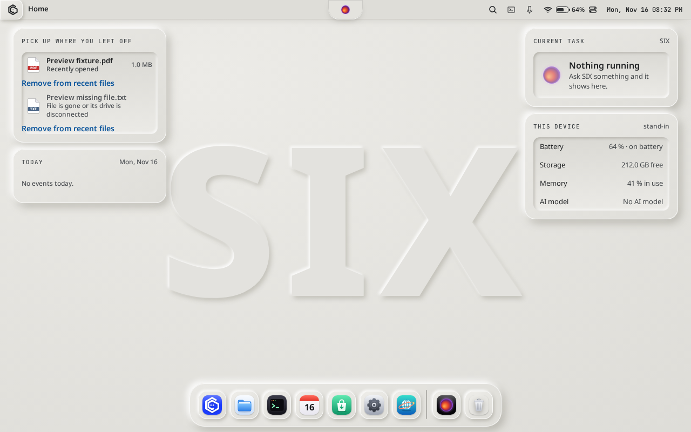

# SIX

SIX is a desktop system built on Fedora Linux with a local AI assistant at its centre: the layout
people know from the Mac, the keys they know from Windows, and an assistant, also called SIX, that
you talk to or type to and that does everyday tasks on the computer, asking before it changes
anything.

This repository holds **SIX's design**: the guide, the design tokens, pictures of every screen as
SIX looks today, the brand, and the October prototype.

- **Start with [design/](design/README.md)**: the two designs (Sculpted, the default, and Soft
  Matter), what is in each folder, and what in the prototype is no longer how SIX looks.
- **Every screen:** [design/screens/](design/screens/README.md).
- **Tokens:** [design/tokens/](design/tokens/README.md).
- **Prototype (October 2026, Soft Matter):** open [design/prototype/index.html](design/prototype/index.html) in a browser.

The design is SIX's own.
