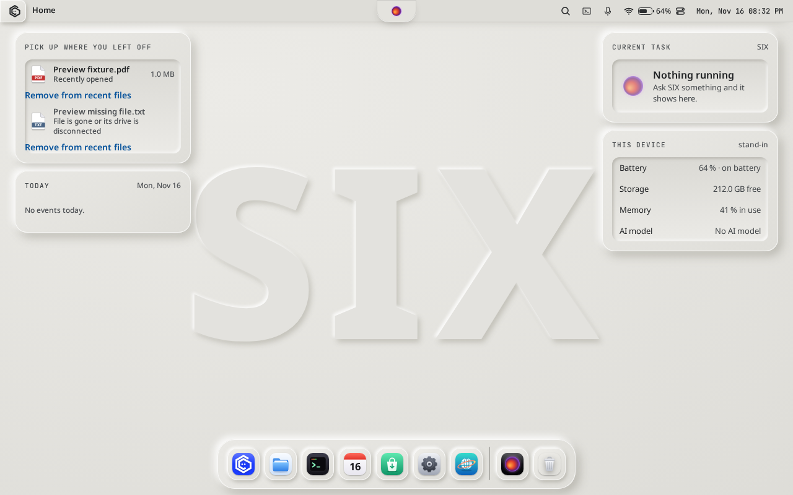
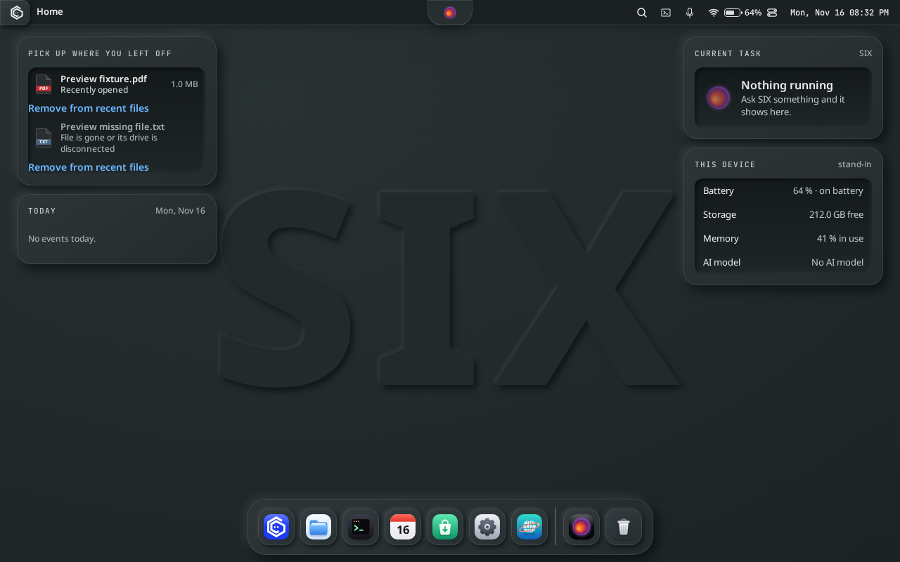
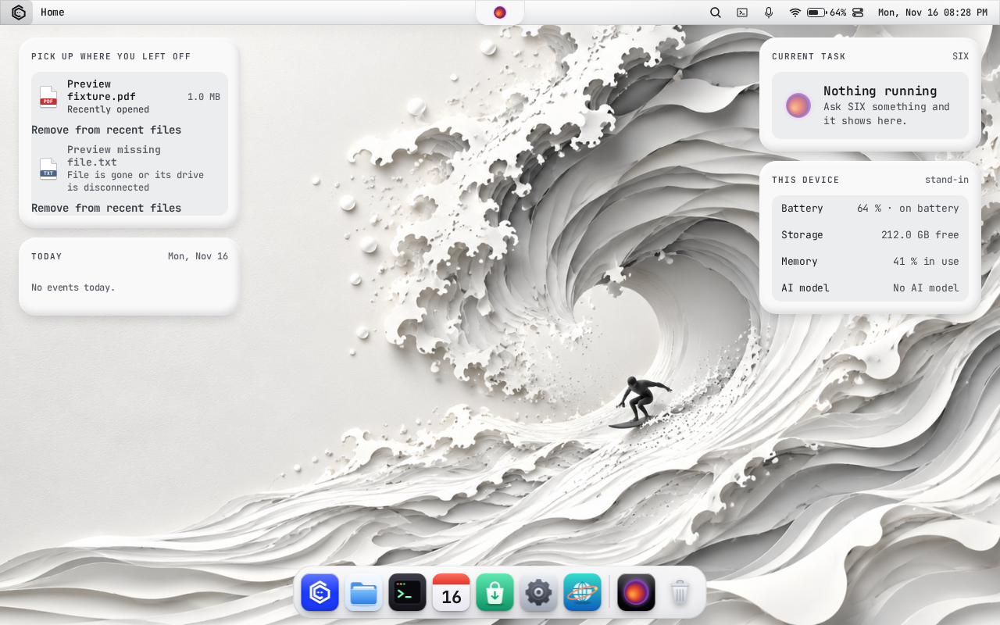
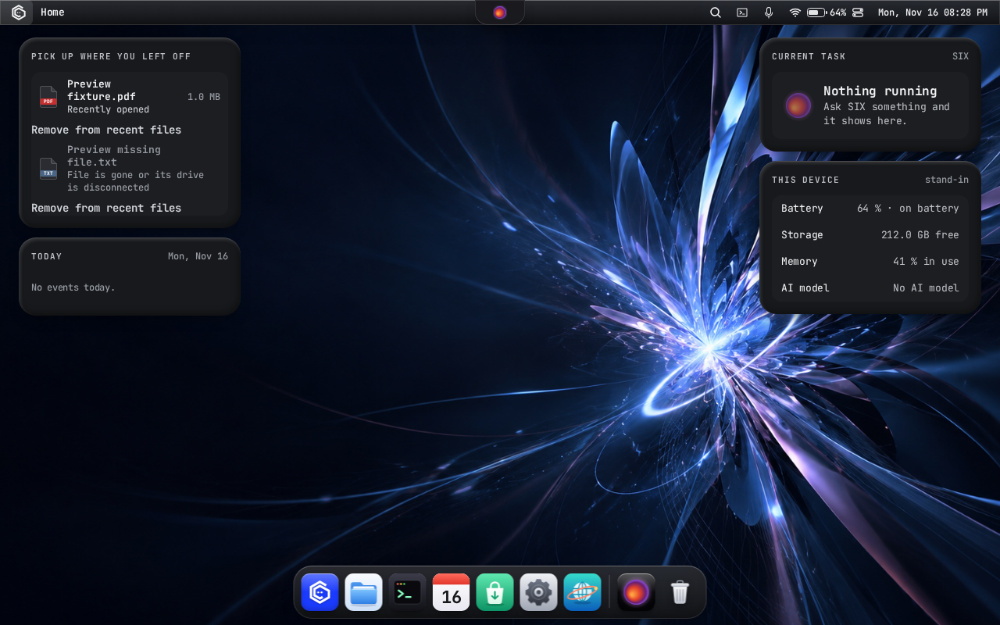

# SIX · the design

The design of **SIX**, a desktop system built on **Fedora Linux** with a local AI assistant at its
centre. The layout is the one people already know from the Mac (a menu bar on top, a dock at the
bottom, window buttons on the right), the keys are the ones they know from Windows, and the
assistant, also called **SIX**, is part of the desktop rather than an app beside it: you talk to it
through **the notch** in the middle of the menu bar, or type to it in the SIX app.

SIX has **two designs**, switched live in Settings › Appearance, each in a light and a dark finish:

- **Sculpted**, the default: ivory and graphite, raised physical controls that sink when pressed,
  deep recessed channels, a limited signal accent (Blue by default), switches that turn green when
  on, Noto Sans, and short, firm motion with no bounce.
- **Soft Matter**, the original: satin controls, clay icons, paper windows, and home cards drawn as
  shallow water that fuse when they come close; terminal type (JetBrains Mono, Share Tech Mono);
  springs with a little give, and surfaces that hold on to each other and snap when pulled too far.

Both are held to one contrast rule: every word and glyph on every screen is measured against what
is really behind it, 4.5:1 for text and 3:1 for large text and glyphs, and 7:1 in **High
contrast**, which both designs also have.

| Sculpted, light (the default) | Sculpted, dark |
|---|---|
|  |  |
| **Soft Matter, light** | **Soft Matter, dark** |
|  |  |

Every screen of today's SIX is in [`screens/`](screens/README.md).

## What is here

| Folder | What it holds |
|---|---|
| [`guide/`](#the-guide) | The design guide, chapter by chapter, with the product's real values |
| [`tokens/`](tokens/README.md) | The design tokens as the product uses them: `tokens.css` (base and Soft Matter), `sculpted.css`, `high-contrast.css` |
| [`screens/`](screens/README.md) | Pictures of every main screen: Sculpted light, the most important screens in Sculpted dark and Soft Matter light and dark, real pictures from an installed system, and the October pictures in `history/` |
| [`brand/`](brand/) | The Hex Face mark, the app icon, the SIX wordmark and lockups (SVG, text outlined); the brand sheet and the October boot animation |
| [`prototype/`](prototype/index.html) | The October 2026 prototype of Soft Matter (see below) |
| [`concepts/`](concepts/tension.html) | The tension studies (elastic surfaces) that Soft Matter's motion came from |
| [`skills/`](skills/tension.skill) | The design skill, packaged |

## The guide

| Chapter | What it covers |
|---|---|
| [19 · Sculpted](guide/19-sculpted.md) | **Start here.** The two designs side by side; Sculpted's palette, accents, depth, geometry, type, states, the one main button, motion and home |
| [01 · Research](guide/01-research.md) | The usability evidence behind the decisions, with sources |
| [02 · Principles](guide/02-principles.md) | Five principles and the "never" list |
| [03 · Typography](guide/03-typography.md) | Noto Sans in Sculpted, terminal type in Soft Matter; the shared type scale |
| [04 · Color](guide/04-color.md) | The contrast rule, High contrast, Soft Matter's colours, the window buttons, wallpapers |
| [05 · Materials](guide/05-materials.md) | Soft Matter's clay, satin, paper and plasma clay; elevation |
| [06 · Layout](guide/06-layout.md) | The 4 px grid, control sizes and radii in both designs, window anatomy |
| [07 · Iconography](guide/07-iconography.md) | System glyphs, app icons, file and place icons |
| [08 · Motion](guide/08-motion.md) | The two feels, durations, the spring roles, reduced motion, tension |
| [09 · Shell](guide/09-shell.md) | Menu bar, the notch, the dock, the SIX Menu and system menu, SIX Search, Control Center as a board of tiles, notifications, right-click menus, shortcuts, windows, snapping and workspaces |
| [10 · Components](guide/10-components.md) | Buttons, switches, inputs, menus, lists, dialogs, toasts |
| [11 · Accessibility](guide/11-accessibility.md) | The built-in modes and the checklist for every screen |
| [12 · Coming from Windows](guide/12-windows-migration.md) | Keys, Windows apps, words |
| [13 · Writing](guide/13-writing.md) | Plain words; the name is SIX |
| [14 · Home](guide/14-home-assistant.md) | Home, the cards and widgets, the weather in three sizes, how SIX's answers are drawn and tagged, its questions and review cards, its orb looks |
| [15 · Testing and build order](guide/15-testing-and-build.md) | Usability tests and the order the design was built in (October) |
| [16 · System apps](guide/16-system-apps.md) | The SIX app, Settings, Files, Software, Calendar, Terminal |
| [17 · SIX on Fedora](guide/17-fedora.md) | The system design on Fedora |
| [18 · Brand](guide/18-brand.md) | The mark, the wordmark, colour, and the system screens: boot, disk unlock, sign-in, lock, the installer |

Where the design shows something SIX does not have yet, the guide says **designed, not built**.

## The prototype

[`prototype/index.html`](prototype/index.html) is the clickable prototype from October 2026, of
Soft Matter only. Its look and behaviour are the design's; its content (a person, meetings, files,
a battery level) is sample content, not SIX's. It is kept as it was. These parts of it are **no
longer how SIX looks**:

- There is no Sculpted design in it; Sculpted is SIX's default.
- The assistant sits as a big orb on home and as an orb at the right of the menu bar that grows
  into a black capsule. SIX now has **no big orb on home** after setup, and lives in **the notch**
  in the middle of the menu bar ([09](guide/09-shell.md#the-notch)).
- Control Center is a set of round buttons; SIX's is a **board of tiles** you can edit.
- The boot screen is an animated cobalt screen with a typed wordmark; SIX's boot is a quiet dark
  screen with the white mark ([18](guide/18-brand.md#boot)).
- The wordmark carries a small "OS"; it is now always the full word **SIX**.
- It offers a Windows-style taskbar layout; SIX has the menu bar and dock only.
- The weather, Files, Settings, Software and Calendar screens are earlier versions; see `screens/`.

## Credits and rights

The design, the Hex Face mark, the wordmark, the icons and pictures SIX draws itself, and the
pictures in `screens/` are SIX's own. The fonts are under the SIL Open Font License (Noto Sans,
JetBrains Mono, Share Tech Mono, VT323). System glyphs are [Phosphor](https://phosphoricons.com)
(MIT). The orb's dotted look is ported from [Thinking Orbs](https://www.thinkingorbs.com/) by
Yogesh ([MIT](https://github.com/yogesharc/thinking-orbs)). SIX is built on Fedora Linux; Fedora is
a trademark of Red Hat, Inc., and SIX is not affiliated with or endorsed by the Fedora Project.
