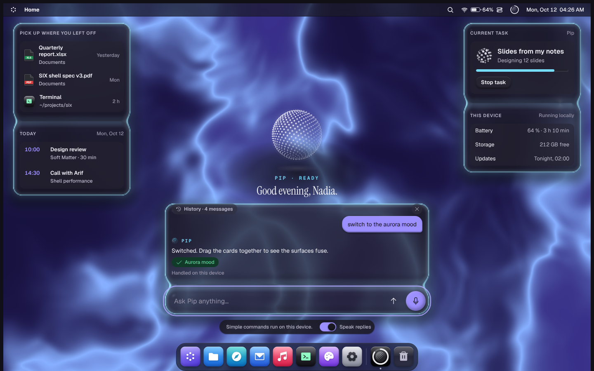
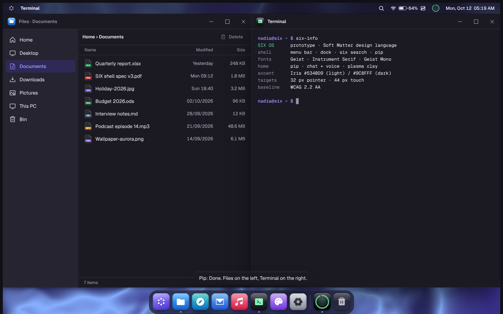

# SIX OS · Soft Matter design language

The design guide for **SIX**, a desktop operating system built to replace Windows on everyday
PCs. Soft Matter keeps the layout Windows users already know and renders it in soft materials:
**clay** you press, **plasma glass** that floats, **paper** you work on, and **plasma clay**, the
liquid surfaces of the home screen, where **Pip**, the assistant, takes chat and voice.


## Start here

| | |
|---|---|
| **Try it** | Open [`prototype/index.html`](prototype/index.html) in a browser. Home is a chat with Pip: try "open Files and Terminal side by side" or the mic. Drag home cards together to fuse them. Drag windows to edges to snap, `Ctrl + K` for Six Search, Quick Settings for dark mode, accessibility and plasma clay settings |
| **Why** | [01 · Research](guide/01-research.md): the usability evidence behind every decision, with sources |
| **Rules** | [02 · Principles](guide/02-principles.md) |

## The guide

| Chapter | What it covers |
|---|---|
| [01 · Research](guide/01-research.md) | Switcher studies, Fitts's law, window management, glass legibility, claymorphism, WCAG 2.2, references (plasma-ui, thinking orbs, 21st.dev, macOS) |
| [02 · Principles](guide/02-principles.md) | Five principles and the "never" list |
| [03 · Typography](guide/03-typography.md) | Inter, Bricolage Grotesque, JetBrains Mono, Noto fallbacks (incl. Bangla), type scale, rules |
| [04 · Color](guide/04-color.md) | Neutrals, Iris accent, semantic colours, clay pastels, plasma moods, verified contrast |
| [05 · Materials](guide/05-materials.md) | Clay, plasma glass, paper, wallpaper, plasma clay (the liquid home surfaces), elevation scale |
| [06 · Layout](guide/06-layout.md) | 4 px grid, control sizes, radii, window anatomy, breakpoints |
| [07 · Iconography](guide/07-iconography.md) | System glyphs, clay app icons, file icons |
| [08 · Motion](guide/08-motion.md) | Durations, easing, springs, choreography, reduced motion |
| [09 · Shell](guide/09-shell.md) | Shelf, Six Menu, Six Search, windows & Snap Layouts, Quick Settings, notifications, Pip in the shelf, Overview, lock screen, first run |
| [10 · Components](guide/10-components.md) | Buttons, toggles, inputs, menus, lists, dialogs, toasts… and a checklist for adopting 21st.dev / shadcn components |
| [11 · Accessibility](guide/11-accessibility.md) | Built-in modes and the per-screen checklist |
| [12 · Coming from Windows](guide/12-windows-migration.md) | Shortcut parity, Windows apps, how change is introduced, term mapping |
| [13 · Writing](guide/13-writing.md) | Voice and UI copy patterns |
| [14 · Home](guide/14-home-assistant.md) | The home screen: Pip, chat, voice, cards, Pip's states |

## Tokens

| File | Use |
|---|---|
| [`tokens/tokens.css`](tokens/tokens.css) | **Source of truth.** CSS custom properties for light, dark and the accessibility modes |
| [`tokens/tokens.json`](tokens/tokens.json) | W3C Design Tokens format for native toolkits (Qt/QML, GTK, Flutter) or Style Dictionary |
| [`tokens/tailwind.preset.js`](tokens/tailwind.preset.js) | Tailwind preset so shadcn/ui and 21st.dev components use SIX tokens |
| [`tokens/build_tokens.py`](tokens/build_tokens.py) | Regenerates `tokens.json` from `tokens.css` |
| [`tokens/check_contrast.py`](tokens/check_contrast.py) | Verifies every text/background pair passes WCAG 2.2 in both themes |

```sh
python3 design/tokens/build_tokens.py     # after editing tokens.css
python3 design/tokens/check_contrast.py   # fails if any pair drops below its minimum
```

## Screens

| Home, light theme | Talking to Pip | Pip snapped two windows |
|---|---|---|
|  |  |  |

| Voice | Phone width | Design guide app |
|---|---|---|
|  |  |  |
