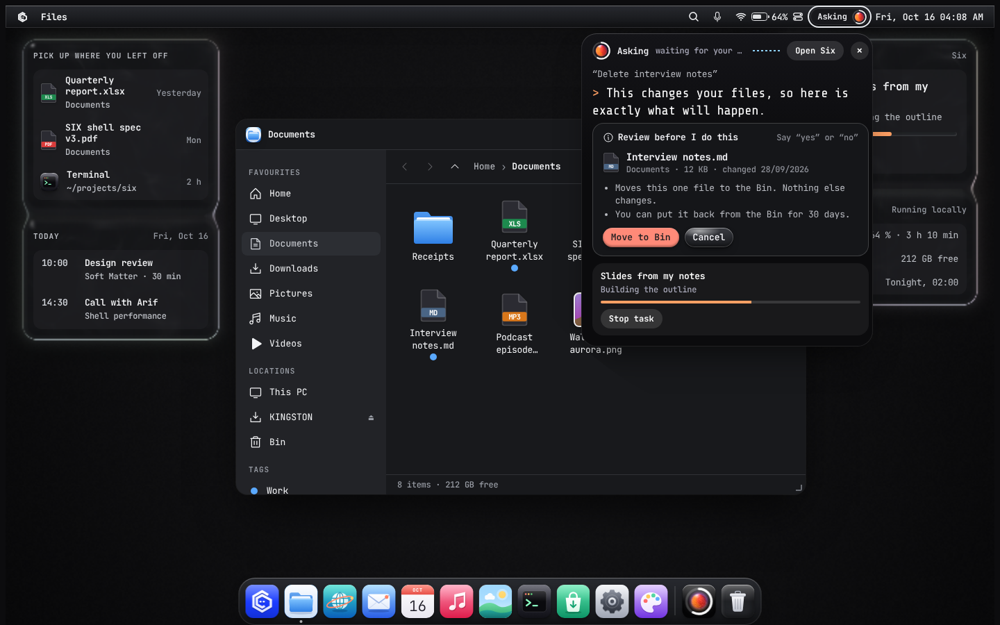
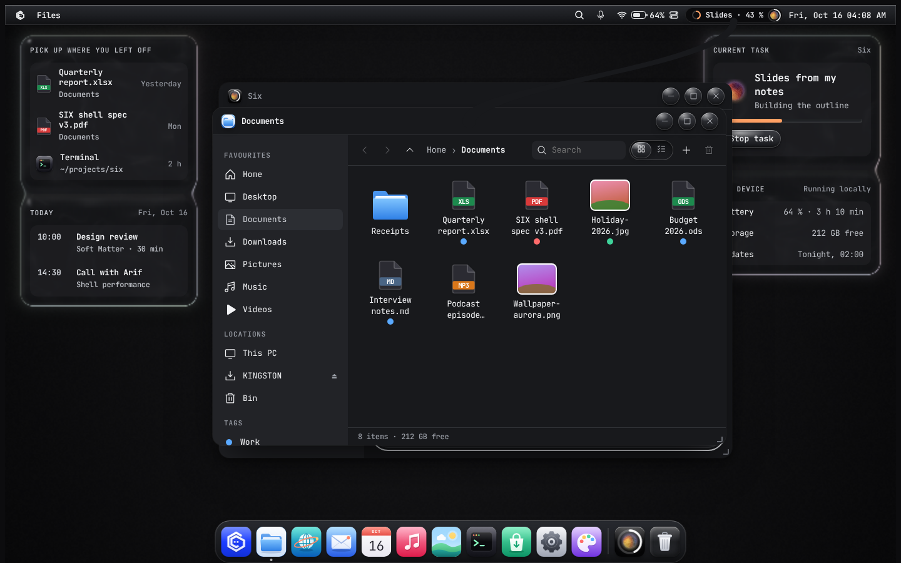

# 09 · The SIX shell

The shell is everything outside app content: the menu bar, the dock, Six Menu, Six Search,
windows, Control Center, notifications, Six's small orb, Overview, the lock screen and the
first-run setup.
The home screen itself, where Six lives, has its own chapter: [14 · Home](14-home-assistant.md).

## Menu bar and dock (macOS-style layout)

SIX's default layout follows macOS: a thin **menu bar** across the top for status, and a
floating **dock** at the bottom for apps. The Windows-style **Taskbar layout** (launcher
bottom-left, one bar with apps, tray and clock) stays available in Settings › Desktop and is the
default when someone imports their data from Windows (see [12](12-windows-migration.md)).

```
┌──────────────────────────────────────────────────────────────────────────────┐
│ ⁘  Files                                      ⌕  wifi ▮▮▯ ◐   ⁘   Mon 12 Oct 10:42 │  menu bar, 32 px
│                                                                              │
│                                 windows / home                               │
│                                                                              │
│              ╭────────────────────────────────────────────────╮              │
│              │ ⁘  ▣  ▣  ▣  ▣  ▣  ▣  ▣  │  ◍  🗑 │              │  dock, 68 px
│              ╰──•──────•───────────────────────•───────────╯              │
└──────────────────────────────────────────────────────────────────────────────┘
```

**Menu bar** (glass, 32 px, full width; 40 px in touch mode)

| Item | Behaviour |
|---|---|
| **Six logo** (left) | The Hex Face mark ([18](18-brand.md)), drawn heavier at menu-bar size. Opens the system menu: About SIX, System Settings, Six Search, Edit widgets, Sleep, Restart, Shut Down, Lock Screen, Log Out. Hit area reaches the top-left screen corner |
| **App name** | Bold name of the focused app ("Home" when none). App menus (File, Edit, View…) follow it |
| **Search** | Opens Six Search (`Ctrl + K`, `Six + Space`) |
| **Control Center** | Wi-Fi, a battery that shows its level and percentage, and a two-toggle glyph; opens Control Center (Quick Settings) under the bar |
| **Mic** | Talk to Six from anywhere (`Six + Space`). Amber pill while Six hears you; a small green dot when *Listen for "Hey Six"* is on |
| **Six** | The small dotted orb at the top right; shows Six's state and a progress ring while a task runs; click → the Six app (the written conversation) |
| **Clock** | "Mon 12 Oct 10:42" in tabular figures; click → calendar and notifications |

**Dock** (glass, 68 px tall, centred, 8 px above the bottom edge, 24 px radius)

| Part | Behaviour |
|---|---|
| **Six Menu** | First icon (graphite squircle with the six-dot mark); opens the Six Menu above the dock |
| **Apps** | Pinned and running apps. Running = a 4 px dot under the icon |
| **Separator** | Thin line before Six and the Bin |
| **Six** | Six's dotted orb on a dark tile; click → the Six app |
| **Bin** | Deleted files; shows a count |
| **Six in the menu bar** | Six's orb, capsule and panel at the right of the menu bar; see [Six in the menu bar](#six-in-the-menu-bar) |
| **Magnification** | Icons near the pointer grow up to 1.5× with a smooth falloff (160 px radius), each on its own spring, so the dock flows rather than snaps (see [08](08-motion.md#choreography)). Off under Reduce motion, on touch, and on narrow screens |
| **Launch lift** | An opening app's icon lifts once, 12 px, while its window grows out of it; never repeatedly for attention (a badge does that) |
| **Labels** | A small glass label above the hovered icon |

Maximized windows fill the space between menu bar and dock; the dock can be set to auto-hide.
Fitts's law still applies: the menu bar items reach the top edge, and the dock's bottom edge
extends to the screen edge.

## Six in the menu bar

There is no notch. Six, the assistant, lives in its orb at the right of the menu bar, and
everything it does grows out of that orb. **When Six is idle it is just the orb.**

| State | When | What it shows |
|---|---|---|
| **Orb** | Six isn't doing anything (music playing, timers and other apps don't count) | Six's orb; click it to open the Six app |
| **Capsule** | Six is working, listening or talking over your windows | The orb grows into a terminal-black capsule that slides out to its left, pushing the status icons over, and types what Six is doing like a terminal line: its task with a progress ring ("Slides · 46 %"), "Slides are ready" for a few seconds when a task finishes, "Listening", or the request it's working on ("searching Documents", "asking Claude"), including ones typed in the Six app. A number that ticks over (46 → 47 %) just changes; new words type in |
| **Panel** | You talk to Six with windows open, or click the capsule | A panel drips down out of the orb: Six's state and source ("Asking · waiting for your review", "on this device"), a voice wave, what you said, Six's reply typed in like terminal output (`> …`) and review cards; below that the running task (with **Stop task**) and, if music is playing, its controls (play/pause, next) |

The panel hangs under the orb, right-aligned to it (as far right as the screen allows), 420 px
wide. It closes 6 s after Six answers (longer while a review waits), or at once with `Esc`, its
×, or a second click on the capsule; a click outside closes an activity panel. Right-click the
orb for *Talk to Six*, *Open the Six app*, *What can Six do?* and Six's settings. It works at
every screen size.

| Moment | Motion |
|---|---|
| Capsule grows | The orb's button widens to the left on the detent spring (560 ms), its ground darkens to terminal black, and the words type in at about 70 characters a second; the status icons slide over with it |
| Panel drips down | A black neck buds from the orb's underside and stretches to the panel (460 ms) while the panel opens as a circle spreading from the orb's position (`clip-path`, 640 ms on the detent spring); its contents fade in with a 6 px focus pull 170 ms later |
| Panel grows | Its height follows the conversation on the precise spring as the reply types in |
| Panel closes | Contents leave first (140 ms), then the circle draws back up into the orb (360 ms, ease-in) and the neck pulls back into it |



**Six reaches for what it changes.** When Six opens, snaps or closes a window, or adds or removes
a widget, a black tendril drops from the orb (or from the open panel) to the window's title bar
(or the widget) and holds on while it moves, so you can see what Six is touching. It then thins in
the middle, lets go, and the two halves draw back into the orb and into the window (about 1.6 s
in all). One tendril at a time; a second action waits its turn. See
[08 · Motion › Tension](08-motion.md#tension).



## Right-click menus

Like Windows, a right-click anywhere in SIX gives the actions for what's under the pointer; text
fields keep their own Cut/Copy/Paste menu. Rows have a 16 px icon, a label, a shortcut or a
submenu arrow, and ticks for options that are on. Submenus open on hover or `→`. `Shift + F10` or
the Menu key opens the menu for whatever has focus; arrows move, `←` or `Esc` go back.

| Where | Menu |
|---|---|
| Home (empty space) | Add widgets…, Talk to Six, What can Six do? · *View ›* Six on home, Keep the intro on home, Put Six back in the middle, Put cards back in their columns · Refresh · *Wallpaper ›* Matte, Obsidian, Signal, Contour, Strata, Velvet · Display settings, Personalise · Open in Terminal |
| A widget | Float on top of everything / Stop floating · *Size ›* (video) · Show all in this stack, Unstack, Put back in its column · Edit widgets…, Remove |
| Six on home, the menu-bar orb | Talk to Six, Open the Six app, What can Six do? · Move Six back to the middle, Hide Six from home · Six & voice settings |
| A window | Restore, Minimise, Maximise, *Snap ›* halves, thirds, quarters · Close (`Alt F4`) |
| A dock icon | Open / Show, Minimise · Keep in dock · Quit; the Bin: Open Bin, Empty Bin…; Six Menu: Six Search, Settings, Lock screen. Dock menus open upward, above the dock |
| A file in Files | Open, Ask Six about this · Copy name, Move to Bin (in the Bin: Put back, Delete permanently…) · Properties |
| Menu bar, anywhere else | Control Center, Six Search, Settings · Lock screen |


**Menus bud from where you click.** The menu opens 8 px from the pointer and grows out of that
point, joined to it by a short neck until it settles; a submenu buds from its row the same way.
Choosing an item draws the menu back into the point it came from, so it's clear what you dismissed
and where. `Esc` closes without the draw-back.

## Six Menu (Start)

Opens above the dock from the Six Menu icon (the Six key does the same), 600 × 720 px max, glass.

```
╭──────────────────────────────────────────────╮
│ [⌕ Type to search…]                          │
│ PINNED                              All apps ›│
│  ▢ Files   ▢ Browser  ▢ Mail   ▢ Settings     │  app icons, 52px, 4–6 per row
│  ▢ Music   ▢ Terminal ▢ Store  ▢ Photos       │
│ RECENT                                  More ›│
│  📄 Quarterly report.xlsx       Yesterday     │
│  🖼 Holiday-2026.jpg           Mon            │
│──────────────────────────────────────────────│
│ (avatar) Nadia Rahman                  ⏻      │
╰──────────────────────────────────────────────╯
```

- Typing anywhere in the menu moves focus into search; no click needed.
- *All apps* is an A–Z list with letter jump (press a letter).
- Recent shows files, not apps, and can be turned off (privacy).
- Power button (⏻) opens Sleep / Restart / Shut down / Sign out. Updates show as "Update and
  restart" here, never as a forced restart.

## Six Search (command palette)

`Six` then type, `Six + Space`, or `Ctrl + Alt + Space`. Centred glass sheet, 680 px wide,
iridescent rim, results appear as you type (< 50 ms target for local results).

| Result group | Example | Enter does |
|---|---|---|
| Top hit | Settings › Display | Opens it |
| Apps | Terminal | Launches |
| Files | budget-2026.ods | Opens; `Space` previews (Quick Look) |
| Settings | "night light" → toggle inline | Toggles without opening Settings |
| Actions | "restart", "empty bin", "new note" | Runs (destructive ones ask first) |
| Answers | `12*18`, `20 usd in bdt`, `time in tokyo` | Copies result |
| Ask Six | Anything else | Shows home and sends it to Six |

**Every result says what Enter will do before it runs.** Settings show their current state and the
change ("Off now · Enter turns it on"); actions name their effect ("Opens it on the left half of
the screen"). Nothing in Six Search acts by surprise.

Each result shows its keyboard shortcut on the right (teaches shortcuts without a manual).
`Tab` reveals secondary actions (Open folder, Copy path, Run as admin…).

## Windows

See [06 · Layout](06-layout.md#window-anatomy) for anatomy.

**Snap Layouts** (from Windows 11, kept identical so muscle memory works):
- Hover the maximize button for 400 ms → a glass flyout shows 6 layouts (halves, thirds,
  quarters, 2/3 + 1/3). Click a zone to snap.
- Drag a window to an edge → halves; to a corner → quarters; to the top → maximize. A glass
  "drop preview" shows the target before release.
- After snapping one window, the remaining zones offer the other open windows (Snap Assist).
- `Six + ←/→/↑/↓` snaps by keyboard.
- **Window groups:** a snapped set appears as one group in the dock's window preview and can be
  restored together.
- **Auto-arrange** (optional per desktop): dynamic tiling that places new windows automatically.

**Title bar rules**
- Apps may put tabs or a search field in the title bar but must leave ≥ 48 px of empty drag area.
- Close always asks to save unsaved work with three buttons: **Save**, **Don't save**, **Cancel**.

## Control Center (Quick Settings)

Opens from the menu bar, under the bar on the right. Glass, 380 px wide.

```
╭────────────────────────────────╮
│  (Wi-Fi)=(BT)  (✈)   (☾)   (☀)    │  round satin buttons, name and state under them;
│  (☝)   (🔕)  [🎙 Listen for "Hey Six"]│  on = the accent's satin; Wi-Fi + Bluetooth fuse
│ (☀ ▓▓▓▓▓▓▓▓▓▓▓▓●        100 %)│  pill sliders: icon and value inside
│ (🔊 ▓▓▓▓▓▓▓●           64 %) │
│ 🔋 64 % · 3 h 10 m left    ⚙   │
╰────────────────────────────────╯
```

- **Related controls fuse.** Wi-Fi and Bluetooth are both radios, so when both are on a bridge of
  the accent colour grows between them and they read as one body. **Airplane mode** turns both off:
  the bridge thins, snaps, and the tiles recoil apart; turning Airplane mode off brings back
  whatever was on. Turning a radio on turns Airplane mode off.
- **Sliders are a membrane.** Pull a slider's thumb up or down off its track and the track bends
  after it; past 100 px it lets go and springs flat. The value only ever follows along the track.
- Each button toggles; its name and state ("Home-5G", "On", "Off") sit under it, so state is
  never shown by colour alone. Right-click a button for its settings page.
- Tiles can be added/removed/reordered (edit mode via the ✎ button).
- *Accessibility* tile is always pinnable and opens the accessibility quick panel (text size,
  contrast, reduce motion, reduce transparency, screen reader, magnifier).
- A wide **Listen for "Hey Six"** tile switches Six between press to talk and always listening;
  its line says which ("Always listening, on this device" / "Off · press the mic to talk").
- The ⚙ button opens Settings at the page you last used. Wallpaper mood and plasma clay controls
  live in Settings › Appearance, not here: Control Center holds only what people change often.

## Notifications

- Appear top-right as glass toasts, 360 px wide, for 6 s (pause on hover; never auto-dismiss if
  they hold an action the user must take).
- Max 3 visible; more are summarized "+4 more".
- Grouped by app in the Notification Center (opened from the clock).
- **Focus** mode silences everything except alarms and allow-listed people/apps; the bell glyph
  shows a moon.
- Each notification has: app icon, title (`text-title-sm`), one-line body, up to 2 actions,
  and a ⋯ menu with "Turn off notifications from this app" (one step to stop spam).

## Six's small orb

Six, the assistant, lives on the home screen as the big realistic orb (see [14 · Home](14-home-assistant.md)).
Everywhere else (menu bar, dock, task cards, message labels) Six is a **dotted sphere**: points on
a slowly turning globe whose light moves differently in each state. It stands in for generic
spinners whenever SIX or Six works on something for more than 2 s without a known percentage.

The motion is ported from [Thinking Orbs](https://www.thinkingorbs.com/) by Yogesh
([MIT](https://github.com/yogesharc/thinking-orbs)), which gives three rules every orb follows:

- **One clock per look.** Every orb in the same state shares one clock, so the menu bar, the dock
  and a task card move in step instead of drifting apart. A frame gap counts at most 100 ms, so an
  orb coming back from a hidden tab carries on rather than jumping.
- **The back fades.** A dot's opacity ramps from 0 just behind the rim to 1 at the front, so the
  far side disappears instead of leaving a grey haze.
- **Nothing below 0.45 px.** About 4 dots per pixel of size (1 for *Background*), each shrinking
  as they multiply, so coverage holds from 16 px to 76 px.

| State | Look | Small orb | Meaning |
|---|---|---|---|
| Ready | Base | Turns once every 6.5 s; the back fades away | Nothing running |
| Working | Working | A ring of light runs down the sphere every 1.7 s, pulling in what it passes | A long task (install, backup, export) |
| | · Gyro | Spins on an axis that circles like a top, the ends twisting against the middle | Alternative for system tasks |
| Thinking | Reasoning | Dims to half; a spark hops dot to dot every 220 ms, trailing its last five hops | Working out an answer |
| | · Twins | Two sparks that keep apart | Comparing or planning |
| Searching | Searching | A lens hops between spots on the face and magnifies them | Looking through files or the web |
| Asking | Searching · Lighthouse | A leaning beam circles every 2.5 s with a fading trail | Waiting for your review |
| Waiting | Waiting | A comet circles and spirals pole to pole | A service made Six wait (rate limit, queue) |
| Retrying | Retrying | Turns, brakes, springs back 60 %, goes again | Trying a failed step once more |
| | · Surge | Each turn launches fast and eases out | Alternative |
| Compacting | Compacting | A line sweeps left to right, packing the dots, then they spring loose | Tidying history, freeing space |
| | · Squeeze, · Fuse | Twist-and-release; a burning fuse with no bounce | Alternatives |
| Background tasks | Background | Fewer, larger dots (· Spiral: eight arms wound pole to pole) | Work running in the background (task cards) |
| Listening | SIX | Ripples spread from the centre | Mic is on |
| Speaking | SIX | Front dots swell with the voice | Reading a reply aloud |
| Complete | SIX | Turns green and glows once | Finished; a toast says what finished |
| Failed | SIX | Turns red (Ember) and slows | Something didn't work; the reason is written beside it |
| Cancelled, Resting | SIX | Dims and almost stops | Stopped by you; focus mode or battery saver |

A view sets the look with `data-state` and, where a state has alternatives, `data-variant`
(`gyro`, `twins`, `lighthouse`, `spiral`, `surge`, `squeeze`, `fuse`).

**Progress.** While a task runs, the menu bar and dock orbs draw a thin ring around the sphere
that fills clockwise with the task's progress (like a dock progress bar on macOS); the tooltip and
accessible name say it in words ("Six · Slides from my notes, 64 %"). The ring disappears when
the task finishes or is stopped.

**Never colour alone.** Complete and Failed change colour, but every state also moves
differently, the tooltip names it, and the label under the home orb says what Six is actually
doing ("Six · searching Documents"). Under Reduce motion the orb is drawn still on a fixed frame
and only redraws when its state changes.

**Listening is impossible to miss.** The menu-bar mic turns into an amber pill whenever Six is
hearing you, separate from Six's orb, so it shows even when Six is busy with something else. With
*Listen for "Hey Six"* on, the mic carries a small green dot: listening for the wake word only,
on this device.

## Overview and desktops

`Six + Tab` or three-finger swipe up. All windows of the current desktop spread out without
overlap; virtual desktops appear as a strip at the top with names. Drag windows between desktops.
Type to filter windows by title.

## Lock and sign-in

- Plasma wallpaper (or the user's photo) with a 72 % dark scrim at the bottom third.
- Clock in `text-hero` (display face, tabular figures), date below in `text-title`.
- Notifications on the lock screen show the app only, not content, by default.
- Sign-in: avatar, name, password field focused immediately (no "press a key" curtain unless
  touch mode). Show-password eye button; caps-lock warning in words.

## First run (out-of-box experience)

1. Language & keyboard (detected; Bangla and English shown first in Bangladesh).
2. Network.
3. **"How do you like your desktop?"** Dock (macOS-style menu bar + dock, default) or Taskbar
   (Windows-style, default after importing from Windows), shown as two live previews.
4. Import from Windows: browser bookmarks, Wi-Fi networks, documents and wallpaper from a backup
   or a network share.
5. Accessibility shortcut: available on every step (`Ctrl + Alt + A` or the ♿ button).
6. Account: local account always allowed, cloud account optional.
