# 09 · The SIX shell

The shell is everything outside an app's content: the menu bar with **the notch** and **the drop**
under its right side, the dock, the SIX Menu, the system menu, SIX Search and the Run box, Control
Center, the calendar and notifications, right-click menus, the shortcut sheet, the second-screen
chooser, the wireless display sheet, windows, snapping and workspaces. SIX draws all of it
itself, above every app's window, in the chosen design. Home has its own chapter
([14](14-home-assistant.md)).

Sizes below are given as Soft Matter / Sculpted where they differ. Pictures: Sculpted light, from
[`screens/`](../screens/README.md).

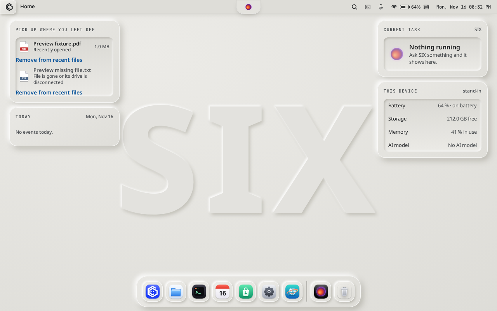

## Menu bar

Full width, 32 / 36 px (40 in touch mode). Sculpted: a quiet bar in `--sc-bar` with a hairline
under it; Soft Matter: satin glass.

| Item | Behaviour |
|---|---|
| **SIX logo** (left) | The Hex Face. Opens the system menu (also `Super + X`): About SIX · Settings… (`Super + I`) · SIX Search (`Super + S`) · What can SIX do? · SIX Guide · Keyboard shortcuts… (`Super + /`) · Edit widgets… · Sleep · Restart… · Shut down… · Lock the screen (`Super + L`) · Log out *name*… The hit area reaches the screen corner |
| **App name** | The front app's name in bold ("Home" when none), and its menu. A long name is cut with an ellipsis before it reaches the notch |
| **The notch** (centre) | SIX and everything that is running; below |
| Workspace dots | One dot for each workspace; a press goes there |
| **Playing now** | SIX's music glyph, only while a media player has something playing or paused; a 4 px dot at its corner while it plays |
| **Weather** | The temperature ("24°"), only while the weather card on home has a reading less than three hours old |
| Search | Opens SIX Search |
| Terminal | Drops down the quick terminal (`Super + `` ` ``), above every app; the same key hides it |
| Microphone | Talk to SIX. While SIX hears you it turns into a warm pill, so listening is always visible |
| Wi-Fi, sound, battery | The network, a muted mark when the sound is off, and the battery with its percentage ("64 %"); each can be hidden in Settings › Control Center › Advanced |
| Control Center | The two-switch glyph; opens Control Center under the bar |
| Clock | The day, the date and the time ("Wed, Nov 18 10:24 AM"), with a moon while Focus is on; opens the calendar and notifications |

The items at the right are 8 px apart and share one centre line. The bar hides over a full-screen
app and comes back at the top edge, or by itself when something waits for the person.

## The drop

Rest the pointer on anything at the right of the menu bar and, after 150 ms, the bar grows a soft
**drop** downward under it that says one thing about that item, in one line. It replaces the
tooltips there. The drop is part of the bar, not a pop-up laid over it: it is made of the bar's own
paint in each look (Sculpted's `--sc-bar`; Soft Matter's satin, with the bar's own 16 px blur over
home; plain `--c-surface` with Reduce transparency or More contrast), and the bar's lower edge line
runs on around its shoulders and its foot. It has no shadow of its own.

| | |
|---|---|
| Shape | The bar's edge, an S-shaped shoulder down each side, a flat foot. Each shoulder spreads 32 px; the words sit 26 px in from each end |
| Size | 28 px tall in Soft Matter, 30 px in Sculpted; as wide as its words, never wider than 340 px; whole pixels |
| Place | Centred on its item and kept on the screen (under the clock it hugs the right edge); it never goes under the notch, keeping 4 px from it |
| Type | 13/16 px; the stronger words in 600, the quieter ones in `--c-text-2`. When room runs out the quieter words give way first, and the stronger ones are never cut while the quieter ones have room |
| Opening | The ground grows from the bar's edge and the words fade in: Soft Matter on the recoil spring (340 ms), Sculpted in 180 ms with no bounce. Reduce motion: no movement at all |
| Moving | Once a drop is open, resting on a neighbour moves it there at once, gliding along the bar |
| Closing | 250 ms after the pointer leaves the item and the drop, so the pointer can travel down into it; 200 ms (Soft Matter) or 140 ms (Sculpted) to go |
| High contrast | A plain outlined box under the bar, 1.5 px line, rounded foot |

What each drop says, always from a real reading; a reading SIX does not have is left out, never
guessed, and an item with nothing to say has no drop:

| Item | The drop says |
|---|---|
| Playing now | The cover (20 px; only from a picture file on this computer that the player names, never fetched from the web; otherwise SIX's music glyph) and "Title · Artist", sliding softly if it is long. After 1.2 s the controls take the name's place: previous, play or pause, next (each only where the player can) and the time left ("-1:13") |
| Weather | "24° Partly cloudy", SIX's own small weather picture, the town, and how old the reading is when it is more than an hour ("2 h ago") |
| Wi-Fi | The network's name, "Wi-Fi is off" or "Not connected" |
| Sound | "Sound 64 %" or "Sound is off" |
| Battery | "64 %" and "Charging", "Plugged in" or the time left ("3 h 10 min left") |
| Clock | The whole date ("Wednesday, Nov 18"), then one thing: "Focus is on", or a bell and how many notifications wait |
| Search, terminal | The name and its key from anywhere ("SIX Search  Super + S") |
| Microphone, Control Center | The name ("Talk to SIX", "Listening", "Control Center") |

Pressing Playing now or Weather **keeps** the drop open, as a small popover: it stays until a
second press, Esc or a press anywhere else. The playing controls are real buttons, reached with
Tab; Esc closes the drop and leaves the focus on its item. There is no drop while a menu, a panel,
SIX Search or the notch's card is open. The drop never shows a player's logo or any other company's
artwork. Settings › Control Center › Advanced has three switches, all on: "Media in the menu bar",
"Weather in the menu bar" and "Menu bar details" (off brings the tooltips back).

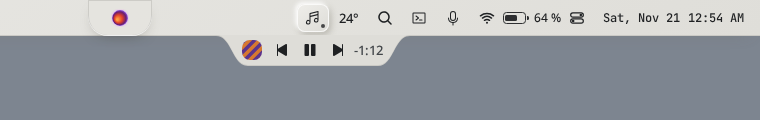
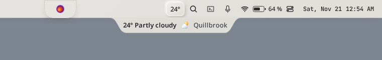

## The notch

SIX, the assistant, lives in **the notch**: a pill hanging from the middle of the top edge, under
the bar, with SIX's orb as its light. There is no hardware cut-out; it is SIX's own shape. It is
drawn in the look's own surface as glass: ivory in Sculpted light, graphite in Sculpted dark,
Soft Matter's surface in its two finishes; a translucent fill (opacity 0.90 in Sculpted, 0.82 in
Soft Matter, chosen so every word passes 4.5:1 over black and over white), an 18 px blur of what
is behind where the system allows it, a fine light inner edge and a soft shadow. Its lower corners
are `--radius-lg`. Reduce transparency, More contrast and High contrast make it solid with a
strong edge.

**Closed** it is at least 64 px wide (idle: the orb alone, nothing moving) and at most 320 px. It
widens to say what SIX is doing, in the turn's own words:

| State | The notch shows |
|---|---|
| Listening | the orb, a live level, "Listening" |
| Working | the orb and the step ("Reading expenses.xlsx", "Still loading the model…") |
| Speaking | the orb, "Speaking" |
| Waiting for you | a "?" mark and the words of the question ("Approve the change?"), with a ring in the accent |
| Done, failed | the turn's own label |

**Everything else that runs** shows as a second part of the same pill, divided by a hairline: a
ring that fills with a real percentage (an install at 42 %), a ring that turns when the source has
no percentage (a copy: bytes, no total), or "Running" beside a count badge. Sources: app installs in
Software, drivers and apps from System Check, copying in Files, cloud downloads, restore points,
the video widget, a command running in Terminal. **Privacy marks** (screen shared, microphone open
for hands-free or "Hey SIX") sit at the left of the pill whenever they are true; the screen share
keeps its one-click **Stop** beside its mark. If the bar is short of room the notch drops its
words and keeps the orb, the marks and the ring.

**Open.** Press the notch (or Enter) and it opens into one card, 520 px wide (at least 96 px tall),
hanging from the top edge with its lower corners at `--radius-xl`. Hold the pointer on it for 0.6 s
to **peek** the same card without taking the keyboard. The card has two parts:

- **SIX:** today's conversation (an answer at most 120 px tall before it scrolls), review cards,
  Stop, **Talk** and **Type instead** (which opens the SIX app).
- **Running now:** one row per activity, with its picture in a small dark well, its title, its
  progress or state, and Stop and Open where the source has them. Every value ends on one right
  edge and every round button on another, also on rows without a button. A row that has ended says
  its state alone ("Done", "Did not finish"); the detail is its hover text. Finished rows stay 6 s,
  failed ones 12 s; "Nothing is running." when empty.

**Approvals in the notch.** A change waits in the card as a review card ([14](14-home-assistant.md#the-review-card)).
It can be approved there only when every cell of the change is in view; otherwise the card offers
to open the SIX app. Sculpted opens the card by sliding it out from under the bar (180 ms, no
bounce); Soft Matter buds it from the notch on a short stem (the recoil spring).

Settings › SIX & voice › The notch: "Show what is running in the notch" (on by default) and one
switch each for installs, files, downloads and playing. SIX's own part and the privacy marks cannot
be turned off.

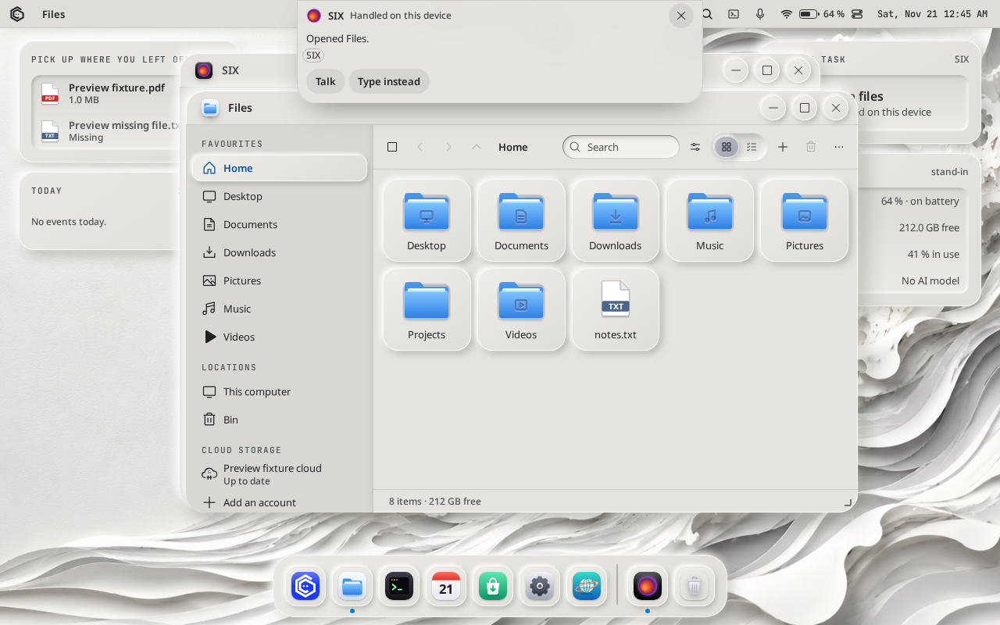

## Dock

Centred at the bottom. Soft Matter: satin glass, 68 px, 48 px icons on a 56 px pitch, 8 px above
the edge, 24 px radius. Sculpted: a raised tray, 80 px, 28 px radius, 10 px above the edge; each
icon (36 px, radius 28 %) sits on its own raised tile (52 px, radius 16) on a 60 px pitch.

| Part | Behaviour |
|---|---|
| SIX Menu | The first icon (the Hex Face app icon) opens the SIX Menu |
| Apps | Pinned and running apps. Running: a 6 px dot in the signal colour under the tile. An app running only on another workspace: a hollow dot |
| Separator | A 2 px line before SIX and the Bin |
| SIX | The SIX app, with the orb as its icon |
| Bin | Deleted files, with Empty Bin in its menu |
| Hover | A label above the icon; for an app with windows, a list of its windows with a small picture of each |
| Badges | A count in the signal colour on the tile's corner; a dot for "needs attention"; a ring round the tile for a command running in Terminal |
| Magnification | Icons near the pointer grow up to 1.5×, each on its own spring, computed once per frame. Off with Reduce motion and in touch mode |
| Hiding | The dock hides while the front window is maximised or full screen and comes back when the pointer reaches the bottom edge |
| Several screens | A dock on each screen |

`Super + 1 … 9` opens or brings forward the app at that place.

## SIX Menu

The first dock icon or the Super key opens the **SIX Menu** above the dock: a search field on top
("Type to search apps, files and settings"; typing anywhere in the menu goes there), **Pinned**
apps as icons with their names, five to a row, **All apps (n)** for the A to Z list, **In your
granted folder** (the files SIX may see, or "Grant a folder…" when none is given), and at the foot
the person's name and the power button. In a full-screen game the first Super press only shows a
small notice; a second press opens the menu (game mode).

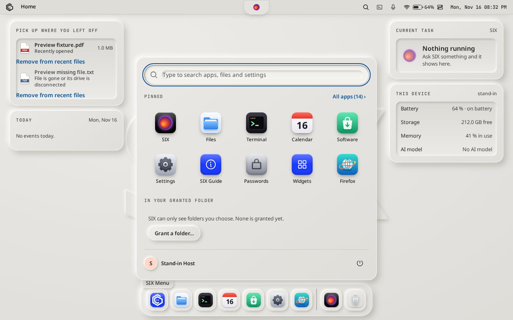

The SIX logo in the menu bar opens the **system menu** (the list in the table above).

## SIX Search

`Super + S` from anywhere (`Ctrl + K` inside SIX's own windows), or the search icon. A centred
sheet (`--radius-2xl`) with one field, results as you type, in groups: **Apps**, **Settings**,
**Files**, actions and answers, keyboard shortcuts, and asking SIX. **Every result says what Enter
will do before it runs**: a setting shows its state and the change ("Off now · Enter turns it on");
a Settings page says where it is ("Settings › Display · Opens it"); an app says "Opens it". The
selected row is recessed and its title is in the accent. Labels, rows and the foot share one 8 px
edge; the foot teaches the keys. Settings come before power actions.

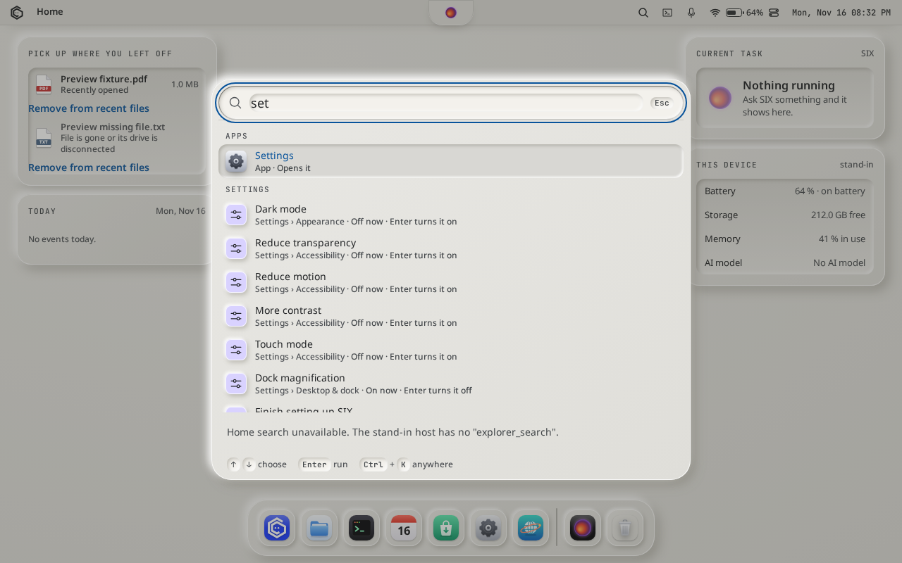

### The Run box

`Super + R` opens SIX Search as a **Run box**: the field has the keyboard and says what it takes,
and the top row says exactly what Enter will start, before it starts it: an app or a setting, a
file or folder by name or by path (`~/Documents`), a web address, or a program with its words
("Starts /usr/bin/kwrite notes.txt as you, in your home folder"). A program is started with its own
words only, never through a shell and never as administrator; anything that would need either is
refused, with the reason under the field. Enter plans again before it runs.

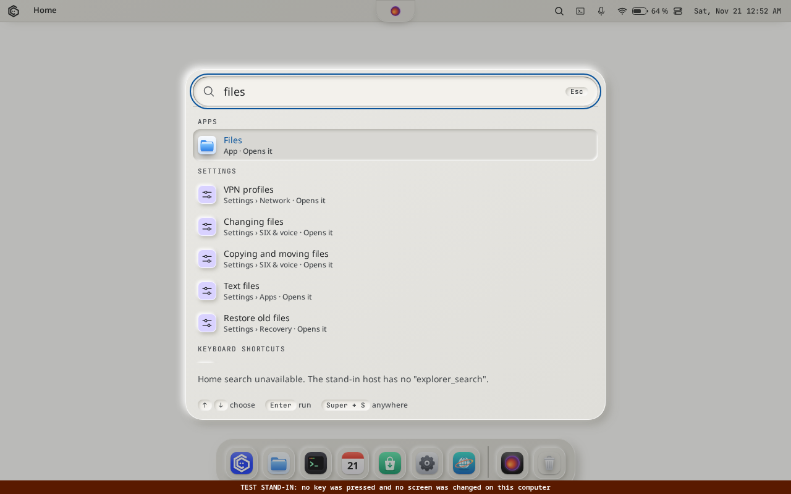

## Control Center

A board of tiles under the bar on the right, opened from the two-switch glyph. One material: tiles
are raised from the panel; anything alive is **a dark window with the accent as its light** (a
switch that is on, the liquid of a level, the battery gauge).

| Tile | Looks like |
|---|---|
| Level (brightness, volume) | A tall pill whose dark fill rises like liquid in a tube, a lit crest, the number at the foot. Drag, wheel, or arrows (±5), Page (±10), Home, End. Volume's icon is the mute button; muted is said in words. Also a wide form |
| Switch | A lamp, a dot and the name. On: the dark window, the lamp lit, the dot filled. Off: a plain raised tile with a hollow dot. Never colour alone. Wide switches write their state (the network's name for Wi-Fi). Wi-Fi and Bluetooth have an arrow part, and a 0.5 s press, that open the network or device list in the panel |
| Battery (wide) | The real percentage in large figures, time left or "Plugged in", a five-cell gauge |
| Power mode (wide) | The profile in use and its place among the others; a press moves to the next |
| Actions | Lock, Sleep, Screenshot, Settings: a rounded square with one word |

SIX's layout: Wi-Fi (wide), Brightness and Volume (tall), Bluetooth (wide), Airplane, Night light,
Dark, Focus, Hey SIX, Touch, Contrast, Low motion, Solid, Battery (wide), Lock; four columns, no
holes. A tile's name is one line: a short word where the full name would wrap ("Low motion" for
Reduce motion, "Solid" for Reduce transparency, "Contrast" for More contrast), and its hover text
and spoken name are the full name, the same words as its row in Settings. While a second screen is
connected a **Screens** tile appears, with the current choice in a word ("Extended", "Same
picture"); a **Cast** tile (wireless display) can be added from the tray. A tile for a part the
computer does not have is not shown; while the computer has not answered, a tile says "Loading…".

**Edit** turns the board into edit mode ("Drag a tile to move it."): a remove mark on each tile, a
size button where the tile has more than one size, an **Add** tray (tiles this computer lacks are
listed, disabled, "Not on this computer"), **Reset to SIX's layout** and **Done**. Keyboard: Tab
to a tile, arrows move it, Delete removes it, S changes its size. **Settings › Control Center**
has the same board as a list, and **Advanced**: what shows in the menu bar, numbers on levels, the
wheel, board size (comfortable, compact), close after a switch, what pressing Wi-Fi or Bluetooth
does.

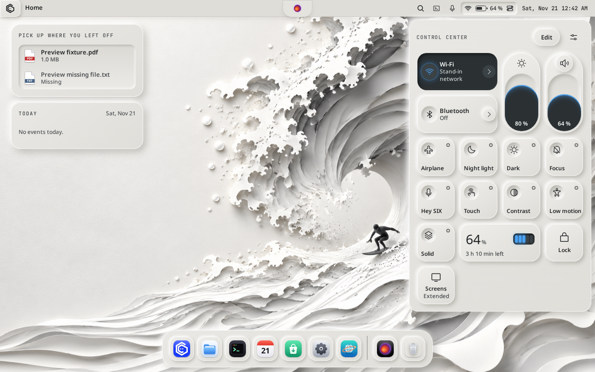

## Calendar and notifications

The clock opens a panel with the month (today filled in the accent) and the notifications, grouped
by app. Notifications appear at the top right as raised cards (`--radius-lg`); an urgent one has a
4 px bar in the danger colour on its left edge. Each has the app's icon, a title, a line, up to two
actions and a reply field where the app offers one; Focus (in Control Center) silences them.
Volume, brightness and other keys show a small on-screen card with a bar in the signal colour.

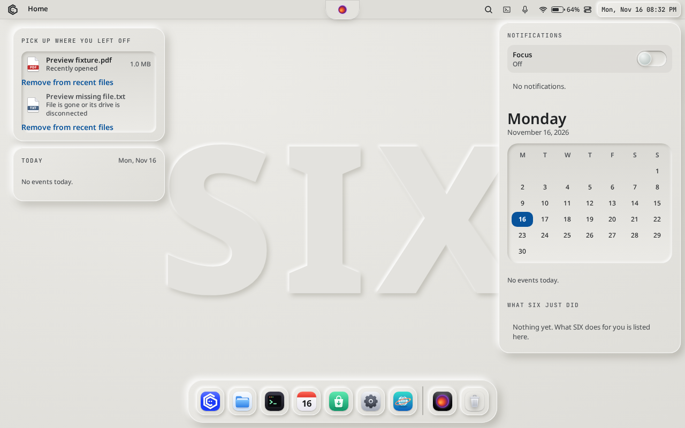

## Right-click menus

A right-click anywhere gives the actions for what is under the pointer; text fields keep their
own Cut, Copy, Paste. Rows are 36 px, with a 16 px icon, the words, a shortcut or a submenu arrow,
and ticks for options that are on; the row under the pointer is recessed (Sculpted) or lit (Soft
Matter); a dangerous row turns the danger colour. Submenus open on hover or →, and flip to the side
that has room. `Shift + F10` or the Menu key opens the menu for what has focus. In Sculpted a menu
fades in over 180 ms; in Soft Matter it buds from the point you clicked and draws back into it.

## Keyboard shortcuts

One list of shortcuts (82 rows) feeds Settings › Keyboard & touchpad, the shortcut sheet
(`Super + /`), the hints in menus, the drop, SIX Search and SIX's answers, and only keys that really
work are in it. Every row has a full description, one to three sentences on what happens, where,
and how to undo it; it is one press away, never on the list itself. In Settings a row is the action
and its keys on one line, and pressing it opens the description under it; the sheet is one column
with the action and its keys on one line and an info mark that shows the description. A group
**Keys on the keyboard itself** names the laptop's own keys (volume, brightness, keyboard light,
media keys, touchpad, display switch, Airplane mode). The main ones:

| Keys | Does |
|---|---|
| `Super` or `Alt + F1` | Open the SIX Menu (in a full-screen game, press twice) |
| `Super + S`, `Super + R` | SIX Search from anywhere; the Run box |
| `Super + A`, `Super + N`, `Super + X` | Control Center; notifications and the calendar; the menu under the SIX logo |
| `Super + D` or `Super + Esc` | Show home; again brings the windows back |
| `Super + M`, `Super + Shift + M` | Minimise every window on this workspace; bring back exactly those |
| `Alt + Tab`, `Super + Tab` | Switch windows; see all windows and workspaces |
| `Super + ←/→/↑/↓` | Snap to a half; from a side half, ↑ and ↓ give the quarters |
| `Super + PgUp` / `PgDown` / `F11` | Maximise / minimise / full screen |
| `Super + Shift + ←/→` | Move the window to the other screen |
| `Super + E`, `Super + I`, `Super + G` | Files, Settings, Settings › Games |
| `Super + U`, `Ctrl + Super + Enter` | Settings › Accessibility; the screen reader on or off |
| `Super + `` ` ``  | The quick terminal |
| `Super + P`, `Super + K` | The second-screen chooser; the wireless display sheet |
| `Super + Space` | The next keyboard layout |
| `Super + Shift + S`, `Print` | Screenshot: an area, a window or the screen |
| `Super + V`, `Super + .` | Clipboard history; emoji and symbols |
| `Super + =` / `-` / `0` | Zoom the screen in, out, back |
| `Super + L`, `Ctrl + Alt + Del` | Lock; sleep, restart, shut down or log out |
| `Ctrl + Super + ←/→`, `+ D`, `+ F4` | Workspaces: go left or right, add one, close this one |
| `Ctrl + Shift + Super + ←/→` | Take the front window to the next workspace |
| `Ctrl + K`, `Ctrl + Space` | Inside SIX's own windows: SIX Search; talk to SIX |

Super belongs to the desktop: SIX's own Terminal uses `Ctrl + Shift` for its keys, so no key of
an app is taken by the desktop first. A key a person gave to another app stays theirs.

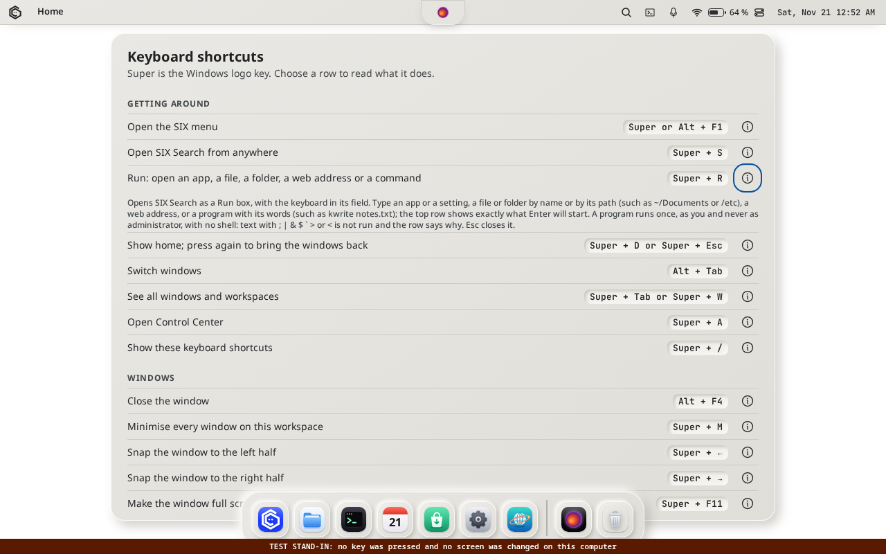
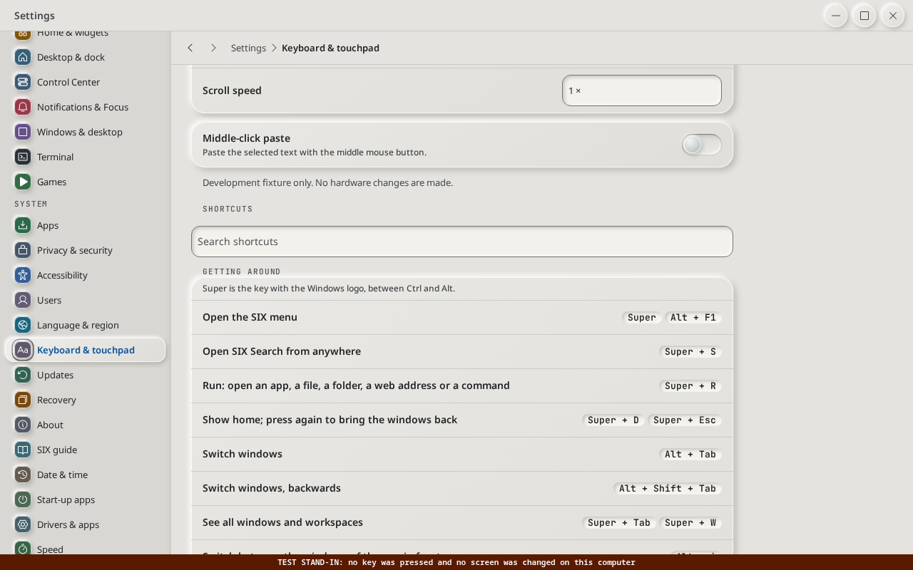

## The second-screen chooser

`Super + P`, the laptop's display key, or plugging in a screen SIX has not seen before opens one
small sheet above every window: **This screen only · Mirror · Extend · Second screen only**, each
with one short line, the current choice marked (a new screen highlights Extend, which is also what
happens if nothing is chosen). Arrows or another `Super + P` move, Enter chooses, Esc closes. When a
screen arrived by itself the sheet closes after 20 s and changes nothing; over a full-screen app
only a notice appears in the notch. With three screens it offers This screen only and Extend to all.
A choice that could leave nothing visible asks **Keep this?** and goes back by itself after 15 s.
A screen SIX knows gets the last choice made with it, and the notch says so ("Extended to …");
unplugging says so too. SIX never turns the computer's own screen off by itself.

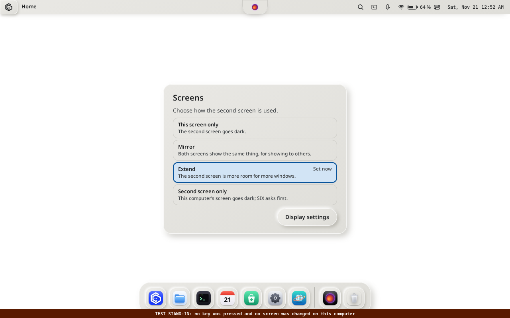

## The wireless display sheet

`Super + K`, the Cast tile, Settings › Display › Wireless display or asking SIX open one short
sheet: what it does in two sentences ("Same picture only: the television cannot be a second screen
yet."), Wi-Fi with its switch, one line saying what to do, and **Look for displays**, which starts
the system's display finder. When it cannot work the sheet says why in words (no Wi-Fi card, Wi-Fi
off, the finder missing) and shows no dead button. While the screen is shared the bar shows
"Sharing your screen" with **Stop**.

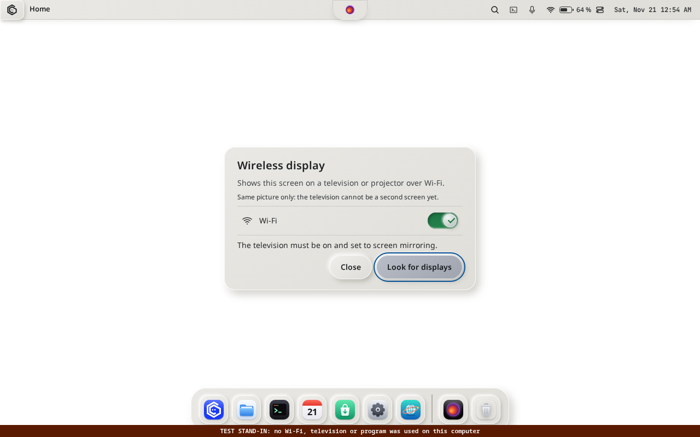

## Windows, snapping and workspaces

SIX's own windows (Files, Settings, the SIX app, Software, Calendar, Terminal) and every other
app's window wear the same frame: the title, then the buttons on the **right**, minimise,
maximise, close; on hover green, blue and red with a white glyph ([06](06-layout.md#window-anatomy)).
Other apps (Qt, GTK, the terminal, LibreOffice) take SIX's colour schemes for the chosen design,
light or dark and accent, so their controls and text match.

- **Snap.** Drag a window to an edge for a half, to a corner for a quarter, to the top to
  maximise; a tinted preview in the signal colour shows where it will land. Hover the maximise
  button for a small panel of layouts; choose a zone. After a snap, **snap assist** offers the
  other open windows for the free side, and two snapped windows resize together.
- **Minimise into the dock.** A minimised window, SIX's or any other app's, goes into its own
  app's icon on the dock, centre to centre along a curve (sideways first, then down into the icon),
  and fades as it lands; the icon gives a small 3 px catch. Reopening brings it out along the same
  curve walked backwards, and asked the other way while it moves, it turns round where it is. 336 ms
  (168 ms for a full-screen window). Settings › Desktop & dock › "Minimise windows with": **Scale**
  (SIX's own movement, the default) or **Lamp**. With Reduce motion it is a 120 ms fade. A window
  whose app has no icon goes to the dock's end; with the dock hidden, to the bottom edge.
- **Workspaces.** Dots for the workspaces; the keys above. The dock keeps every app and marks
  apps that run only on another workspace with a hollow dot.
- **Not responding.** When an app stops answering, SIX's own sheet says so in plain words, with
  **Wait** as the main button, **Force quit**, and Details.

## What is designed, not built

The Windows-style taskbar layout (one bar along the bottom) is in the design and not in SIX: SIX
has the menu bar and the dock. Overview with a strip of named desktops and typing to filter
windows is designed; today `Super + Tab` shows the windows and workspaces.
