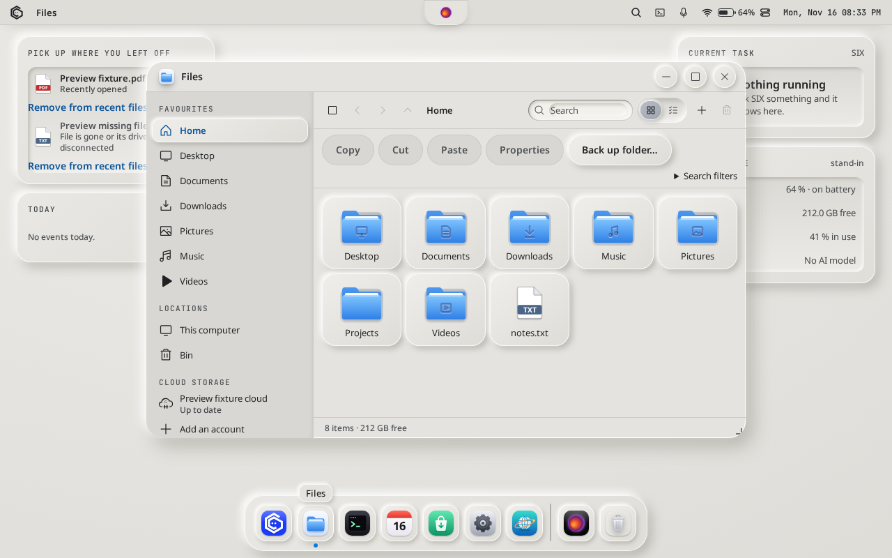

# 16 · System apps

The apps that come with SIX and are drawn by SIX itself, in the chosen design: **the SIX app**,
**Settings**, **Files**, **Software**, **Calendar** and **Terminal**. They open as windows over
home, with SIX's frame and the buttons on the right ([06](06-layout.md#window-anatomy)). Other
apps (the browser, LibreOffice, KDE's apps) are not SIX's, but take SIX's colour schemes for the
chosen design, finish and accent.

Pictures are Sculpted light; [`screens/`](../screens/README.md) has the dark and Soft Matter ones.

## Shared rules

| Rule | Why |
|---|---|
| **The sidebar is the map.** Places (Files), sections (Settings), categories (Software) and conversations (the SIX app) are always on the left. In Sculpted the sidebar is a recessed channel and the chosen row is raised, its words in the accent | Nothing important hides behind a menu button |
| **The header says where you are**, in plain words: a path (Files), the page (Settings), the category (Software) | "Where am I?" is always answered |
| **Back and forward everywhere**: ‹ › in the toolbar, `Alt + ←/→` | One habit across every app |
| **Deep links.** Any part of SIX can open an app at a place: a Control Center tile opens its Settings page, SIX opens *Settings › Display*, the Bin opens *Files › Bin*, a search result opens the row it found and highlights it | No hunting for a page that was mentioned |
| **Empty states explain**: "No events on this day. Add one to keep it here and in Today on home." | An empty view teaches |
| **What is missing says so**: a part the computer does not have reads "Not on this computer"; a part SIX does not have reads "Not built in SIX yet", in words, never a control that does nothing | Nothing fake may look real |

## The SIX app

The written side of the assistant; home and the notch are the spoken side ([14](14-home-assistant.md)).

| Part | Today |
|---|---|
| Sidebar | **New chat**, then the conversations of this session; a note at the foot says how long they are kept and that files are checked again before any change |
| Header | The conversation's title, and where answers come from ("No AI model · plain commands run on this device" when no model is installed) |
| Empty state | SIX's orb, **Ask SIX anything**, one line on what SIX can do, and four example requests as buttons |
| Thread | Your messages and SIX's answers; answers drawn as paragraphs, lists, code and tables, each tagged `local model` or `SIX`; review cards, plans with steps, "Is that right?" and "Check on the web" |
| Composer | "Message SIX…", a microphone for dictation and Send, which becomes Stop while SIX answers |

## Settings

**Sections**, in the sidebar in four groups, each page with its own coloured tile, and a search
field on top that looks through every row's title, description and choices (choosing a result
opens the page, scrolls to the row and highlights it):

| Group | Pages |
|---|---|
| Connect | Accounts & messages · Wi-Fi · Cloud storage · Bluetooth · Phone · Network |
| Device | Display · Sound · Battery & power · Storage · Printers & scanners · Drives |
| You | SIX & voice · SIX account · Appearance · Wallpaper · Home & widgets · Desktop & dock · Control Center · Notifications & Focus · Windows & desktop · Terminal · Games |
| System | Apps · Privacy & security · Accessibility · Users · Language & region · Keyboard & touchpad · Updates · Recovery · About · SIX guide · Date & time · Start-up apps · Drivers & apps · Speed |

**Pages** are columns of rounded groups; each row has a title, an optional plain line under it,
and one control on the right (a switch, a segmented choice, a menu, a button or a value). A row
never holds two controls. **The danger button**: a choice that loses something (reset, remove,
delete) is drawn as the dangerous button, never as the main one, and asks first, saying what will
be lost. Settings that also live in Control Center change in both.

Some pages, briefly: **Appearance** (the design, Sculpted or Soft Matter, each shown as a small live window with a
button, a switch and a slider; the theme, System / Ivory / Graphite in Sculpted's words; the
accent; the drawn wallpapers; a link to Wallpaper for pictures), **SIX & voice** (how to talk, the orb's look, spoken replies, the
notch's switches, the folder SIX may see, "Check how SIX hears you"), **Control Center** (the board as
a list, Advanced), **Games** (game mode, "Check this computer for games", "Set up Steam", your
games), **Drivers & apps** (System Check: drivers and apps found from trusted sources, installed on
approval), **Recovery** (the previous version, restore points of files, reset), **Speed** (what SIX
does to keep the computer quick, and the switch).

## Files

A plain file manager for the person's home folder (it never asks; what the assistant may see is a
separate grant, in Settings › SIX & voice).

| Part | Today |
|---|---|
| Sidebar | *Favourites* (Home, Desktop, Documents, Downloads, Pictures, Music, Videos), *Locations* (This computer, drives, the Bin), *Cloud storage* (each account as a folder, with its state, and "Add an account") |
| Toolbar | Select, ‹ › and ↑, the path, search, icons or list, new folder, move to the Bin; a row of actions for what is selected (Copy, Cut, Paste, Properties, Back up folder…) and search filters |
| Icon view | Folders with their emblem, file icons with a coloured band for the type; names wrap |
| Status bar | The item count and free space, or what is selected |
| Keyboard | Enter opens, F2 renames, Delete moves to the Bin, `Alt + ←/→` back and forward, `Alt + ↑` or Backspace up |
| Open | Every file opens with the system's app for its kind; when one cannot, SIX says why |

Every move to the Bin has **Undo**; the Bin remembers where things came from and has **Put back**;
deleting from it asks first, because it cannot be undone. Files can also edit PDFs (combine, split,
rotate, delete or move pages, add text or a signature picture), always into a new copy.

## Software

Apps from Flathub, installed for the person's account. Sidebar: search, **Explore**, Work, Create,
Develop, **Play**, **Windows apps**, Installed, Updates. Explore opens with "Make yourself at home"
and a **Coming from Windows?** card (Bottles for Windows programs, Steam with Proton for Windows
games, "compatibility varies; check each program before relying on it"). Each app is a card: icon,
name, one plain line, the source and state ("Flathub · Available"), and one button. An install
shows Flathub's own percentage, in the card and in the notch.

## Calendar

The month in a grid (weekday header, the days as recessed cells, today marked in the accent), ‹
**Today** › at the top, and the chosen day on the right with its events, **Add event** and "Saved
on this computer". Today's events also show in the Today card on home and in the clock's panel.
Deleting an event asks first, with the danger button.

## Terminal

SIX's own terminal: tabs (a tab can be torn off into its own window), **Ask SIX** in the toolbar,
help and settings; a first-use line explains `Ctrl + C` (copies selected text, otherwise stops the
program) and `Ctrl + V`. The **quick terminal** drops down from the top on `Super + `` ` `` over
every app. A long command shows as a ring on the dock's Terminal icon and in the notch. Settings ›
Terminal has the text size and a screen-reader mode. (The picture tool used for this repository
has no real shell behind it, so Terminal is described here and not shown.)

## Lock screen

See [18 · Brand › Sign-in and lock](18-brand.md#sign-in-and-lock).
