# 16 · System apps

The apps that come with SIX and are drawn by SIX itself, in the chosen design: **the SIX app**,
**Settings**, **Files**, **Software**, **Calendar** and **Terminal**. They open as windows over
home, with SIX's frame and the buttons on the right ([06](06-layout.md#window-anatomy)). Other
apps (the browser, LibreOffice, KDE's apps) are not SIX's, but take SIX's colour schemes for the
chosen design, finish and accent.

Pictures are Sculpted light; [`screens/`](../screens/README.md) has the dark and Soft Matter ones.

## Shared rules

| Rule | Why |
|---|---|
| **The sidebar is the map.** Places (Files), sections (Settings), categories (Software) and conversations (the SIX app) are always on the left. In Sculpted the sidebar is a recessed channel and the chosen row is raised, its words in the accent | Nothing important hides behind a menu button |
| **The header says where you are**, in plain words: a path (Files), the page (Settings), the category (Software) | "Where am I?" is always answered |
| **Back and forward everywhere**: ‹ › in the toolbar, `Alt + ←/→` | One habit across every app |
| **Deep links.** Any part of SIX can open an app at a place: a Control Center tile opens its Settings page, SIX opens *Settings › Display*, the Bin opens *Files › Bin*, a search result opens the row it found and highlights it | No hunting for a page that was mentioned |
| **Empty states explain**: "No events on this day. Add one to keep it here and in Today on home." | An empty view teaches |
| **What is missing says so**: a part the computer does not have reads "Not on this computer"; a part SIX does not have reads "Not built in SIX yet", in words, never a control that does nothing | Nothing fake may look real |

## The SIX app

The written side of the assistant; home and the notch are the spoken side ([14](14-home-assistant.md)).

| Part | Today |
|---|---|
| Sidebar | **New chat**, then the conversations of this session; one line at the foot, "Kept until SIX closes.", with the rest behind it |
| Header | The conversation's title, on the thread's text edge, and where answers come from ("No AI model · plain commands run on this device" when no model is installed) |
| Empty state | SIX's orb, **Ask SIX anything**, one line, and example requests as buttons of one to three words ("10-minute timer"); each sends its whole request, which is its hover text |
| Thread | Your messages and SIX's answers; answers drawn as paragraphs, lists, code and tables, each tagged `local model` or `SIX` (or `cloud model · <name>` with "Show what is sent", when the person chose SIX Cloud); review cards, plans with steps, "Is that right?", "Check on the web", and "Ask the stronger model" where SIX Cloud is set up |
| Composer | One field, "Message SIX…", a microphone for dictation and Send, which becomes Stop while SIX answers. Notices take their own strip under the app, never over the composer |

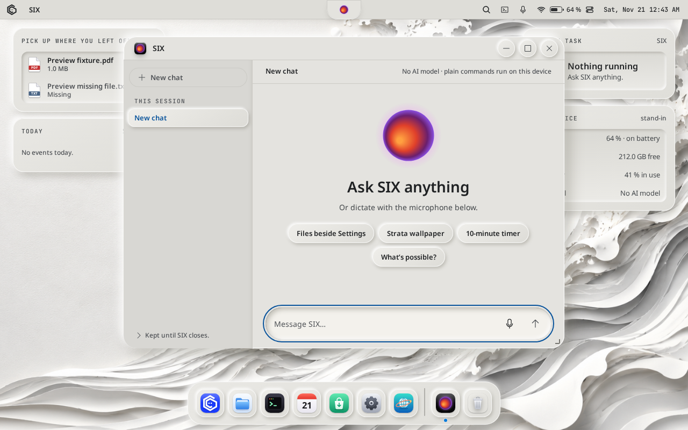

## Settings

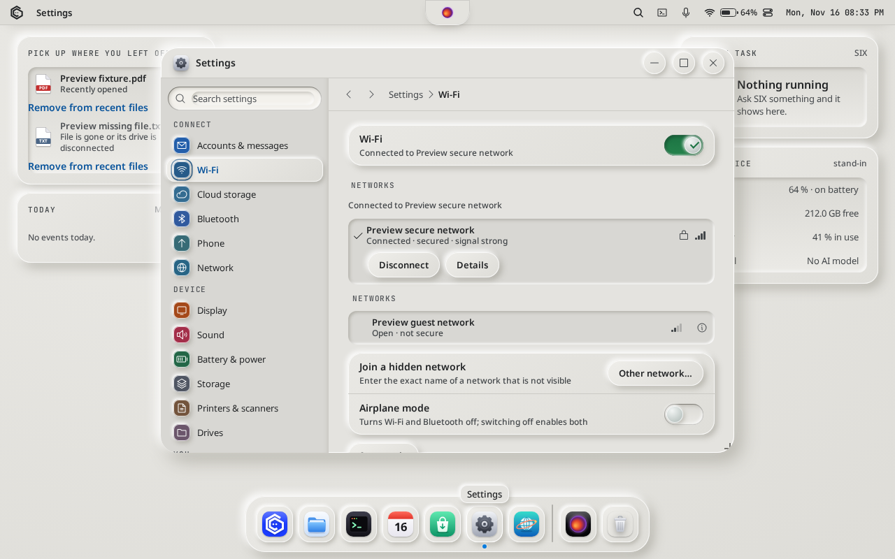

**Sections**, in the sidebar in four groups, each page with its own coloured tile, and a search
field on top that looks through every row's title, description and choices (choosing a result
opens the page, scrolls to the row and highlights it):

| Group | Pages |
|---|---|
| Connect | Accounts & messages · Wi-Fi · Cloud storage · Bluetooth · Phone · Network |
| Device | Display · Sound · Battery & power · Storage · Printers & scanners · Drives |
| You | SIX & voice · SIX account · Appearance · Wallpaper · Home & widgets · Desktop & dock · Control Center · Notifications & Focus · Windows & desktop · Terminal · Games |
| System | Apps · Privacy & security · Accessibility · Users · Language & region · Keyboard & touchpad · Updates · Recovery · About · SIX guide · Date & time · Start-up apps · Drivers & apps · Speed |

**Pages** are columns of rounded groups, all one width; each row has a name, at most one short line
under it, and one control on the right (a switch, a segmented choice, a menu, a button or a value).
A row never holds two controls. In a group whose rows are all one line the rows are 48 px tall; in a
group with a two-line row every row is 64 px. Group labels, notes and the words in the cards start
on one text edge, and the controls end on one right edge; a menu or a field at a row's end is one
width on every page (at most 14 rem, with an ellipsis inside). A value is said once on a page, and
**Refresh** sits at the end of the heading or inside the row it reads again, never as a row of its
own. What a person may want but does not need for the next action is behind a closed **Details**
line that opens in place (every fold in SIX draws the same chevron); the words taken off a row are
still found by the search. **The danger button**: a choice that loses something (reset, remove,
delete) is drawn as the dangerous button, never as the main one, and asks first, saying what will
be lost. Settings that also live in Control Center change in both.

Some pages, briefly: **Appearance** (the design, Sculpted or Soft Matter, each shown as a small live window with a
button, a switch and a slider; the theme, System / Ivory / Graphite in Sculpted's words; the
accent; the drawn wallpapers; a link to Wallpaper for pictures), **SIX & voice** (how to talk, the orb's look, spoken replies, the
notch's switches, the folder SIX may see, "Check how SIX hears you"), **Control Center** (the board as
a list, Advanced), **Games** (game mode, "Check this computer for games", "Set up Steam", your
games), **Drivers & apps** (System Check: drivers and apps found from trusted sources, installed on
approval), **Updates** (the version by SIX's own number, "SIX 0.8.1"; a check and a download that
never restart the computer by themselves; "What's new", the notes of the version that is ready and
of the one running), **Recovery** (the previous version, restore points of files, reset), **About**
(the device, SIX's version, the base system's own number one press away), **Speed** (what SIX
does to keep the computer quick, and the switch), **Keyboard & touchpad** (the shortcut list,
above in [09](09-shell.md#keyboard-shortcuts), and "Which key is this?"), **Desktop & dock** (the
dock, and "Minimise windows with: Scale / Lamp"), **SIX account** (sign in with a one-time link
code, this month's use, sign out this computer; where answers come from is "This computer only"
until the person chooses otherwise).

**Display with two screens or more** draws the screens at the top (SIX's own drawing: a rectangle
each with its number and name, "Main" on the main one, "Off" on a dark one), then **Show numbers**
(a large number on each screen for 4 s), the same four choices as the chooser, **Where is the
second screen?** (Left · Right · Above · Below), **Main screen** (where home and SIX's cards are; the
bar and the dock are on every screen) and, for the screen chosen in the drawing, rotation, scale,
resolution and refresh rate. A change that could leave nothing visible asks **Keep this?** and goes
back after 15 s. With one screen the page says that connecting a monitor, a television or a
projector makes SIX ask how to use it. **Wireless display** is a row of its own, opening the sheet
of [09](09-shell.md#the-wireless-display-sheet).

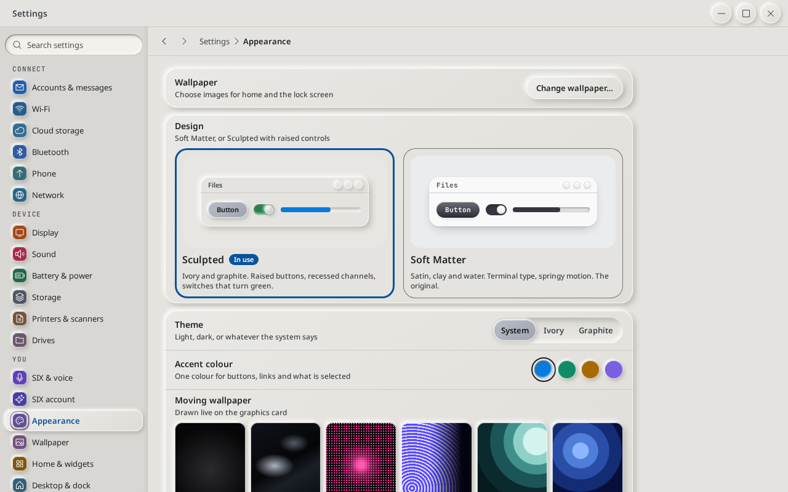
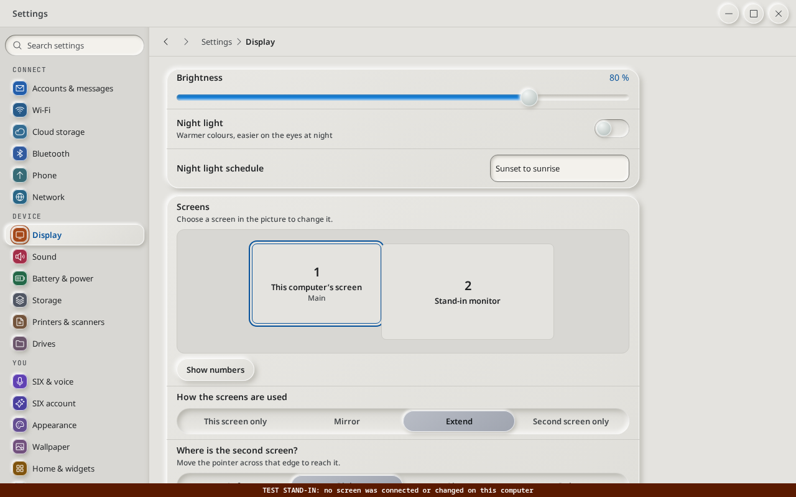

## Files

A plain file manager for the person's home folder (it never asks; what the assistant may see is a
separate grant, in Settings › SIX & voice).

| Part | Today |
|---|---|
| Sidebar | *Favourites* (Home, Desktop, Documents, Downloads, Pictures, Music, Videos), *Locations* (This computer, drives, the Bin), *Cloud storage* (each account as a folder, with its state, and "Add an account") |
| Toolbar | One toolbar, 56 px, the same as Software's: Select, ‹ › and ↑, the folder's name, search (one field) with a filters button beside it that shows when a filter is set, icons or list, new folder, move to the Bin, and **More actions** (three dots: Copy, Cut, Paste, Properties, Back up folder…, also in the right-click menu and on their keys). In a window 820 px wide or less the side list is a rail and the folder's name keeps its room before the search field |
| Icon view | Folders with their emblem, file icons with a coloured band for the type; names wrap |
| Status bar | The item count and free space, or what is selected; column names, row names and the status line start on one 20 px edge |
| Keyboard | Enter opens, F2 renames, Delete moves to the Bin, `Alt + ←/→` back and forward, `Alt + ↑` or Backspace up |
| Open | Every file opens with the system's app for its kind; when one cannot, SIX says why |

Every move to the Bin has **Undo**; the Bin remembers where things came from and has **Put back**;
deleting from it asks first, because it cannot be undone. Files can also edit PDFs (combine, split,
rotate, delete or move pages, add text or a signature picture), always into a new copy.

### Cloud storage in Files

Each cloud account is a folder in the side list. A cloud folder read before is on screen at once
(back, forward, up, home and back, Files reopened), and the fresh reading replaces it in place;
"Reading cloud folder…" shows only for a folder never read. The path is one line. Browsing goes on
while a file is fetched. **Kept folders** (folders kept on this computer and synced both ways) are
behind one button, in a sheet whose title, status line and **Close** stay in view; each kept folder
says its state in a word or two ("Up to date", "Syncing", "Waiting to upload"), with **Why** and
**Both copies kept** under it where there is something to read. A sync that stops says which kind
of stop it is:

| State | Means |
|---|---|
| **Will try again by itself** | The service could not be reached, or a run was cut off; SIX goes on by itself and does not count it as a problem |
| **Stopped for safety** | More than a quarter of the files were deleted on one side; nothing more is changed until the person looks |
| **Stopped until you act** | The folder is gone from its place in the cloud, the kept folder was emptied on this computer, or the sync's history was lost |

A copy kept after a conflict keeps its file ending (`report.six-conflict-….txt`), so it opens with
its app. The sheet's foot is one sentence: stopping keeping leaves the copy on this computer, and
opened cloud files take about 2 GB here.

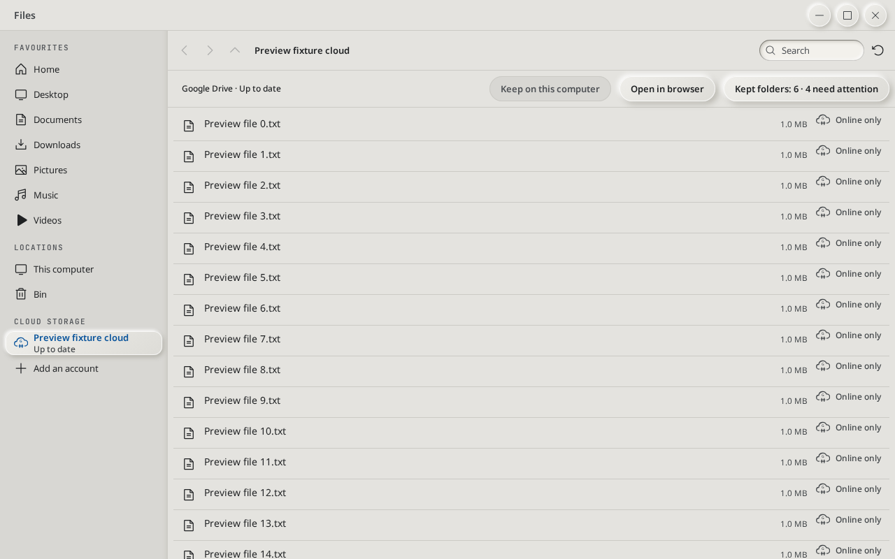
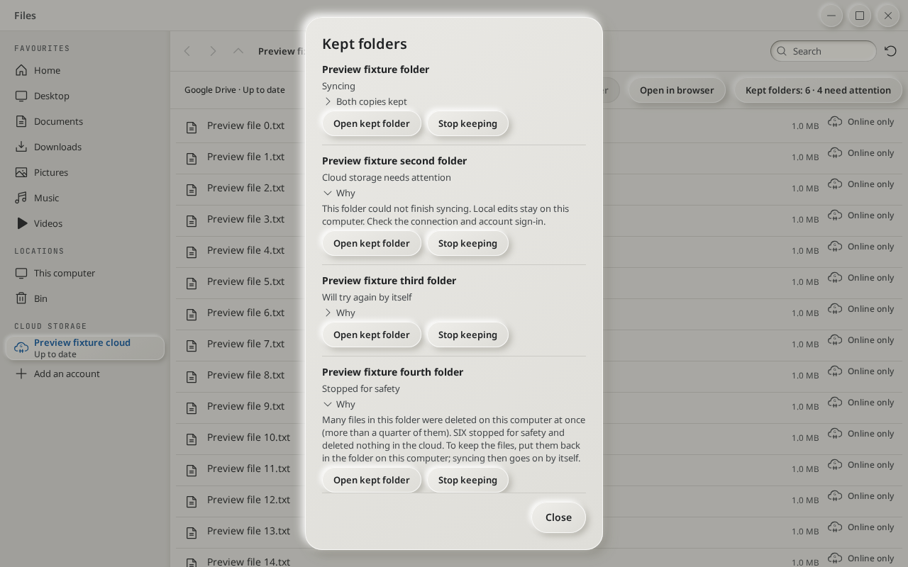

## Software

Apps from Flathub, and the apps of ArtCraft from ArtCraft's own app source, installed for the
person's account. Sidebar: search, **Explore**, Work, Create, Develop, **Play**, Learn, Talk, Music
& video, Tools, **Windows apps**, **ArtCraft**, Installed, Updates; the sections are Flathub's own
categories. Explore opens on **SIX's picks**, ten well-known apps for a new computer (the heading's
hover text says it is not a ranking: SIX shows no ratings or download counts), and a **Coming from
Windows?** banner of one line ("Many Windows programs and games run here; some do not."). Search ranks names first and forgives case,
spaces and one wrong letter; it pages through every result ("48 of 212 apps · Show more"). A
search for "Word", "Photoshop" or another Windows-only name leads to SIX's apps for that job, with
one honest line ("Microsoft Word is not made for Linux.").

**A card** (the grid's cards are all one size, at least 185 px wide, 16 px gaps) is the app's
logo (40 px), its name, its maker's own summary in at most two lines, one quiet line (what a pick is
for, its state, or its source: "From Flathub"; "ArtCraft · 0.21.1"), and one button.

**An app's page** is its logo (64 px), name, summary, one state line ("For your account, from
Flathub.") and **Install**. Who makes it, the licence, version and date, the sizes, what it may
reach in plain words ("Your Downloads folder", "The internet", "All your files and folders") and
content notes are one table one press away, under **About this app**; a fact the source does not
state says so. An install shows the installer's own percentage, in the card and in the notch, and
goes on with Software closed; it ends with "VLC is installed. It is in the SIX Menu now." and
**Open**. **Uninstall…** is in the right-click menu of an app the person installed (the SIX Menu,
the app grid, the dock), and asks whether to delete the app's own data too.

### The logo, and the letter tile

Every app in Software, in the Play places and on an installer sheet shows **its own logo**: the
source's icon, else the icon the installed app gives, drawn as supplied (never recoloured, cropped
or tinted), in a whole-pixel square of 40 px (cards, sheets) or 64 px (an app's page, Play's
banner). An app with no icon gets a **letter tile**, never the same generic picture for every app:

| | |
|---|---|
| Letter | The first letter or digit of the app's name, upper case, in any script; "?" when there is none |
| Tint | One of SIX's six clay tokens (`--clay-lilac`, `--clay-mint`, `--clay-peach`, `--clay-sky`, `--clay-butter`, `--clay-rose`), chosen from the app's id by a stable hash, so one app always has the same tint |
| Shape | A 1 px `--c-line` border; radius `--radius-sm` (8 px) at 40 px, `--radius-md` (12 px) at 64 px |
| Type | The letter in `--c-text`, `--text-title` at 40 px, `--text-title-lg` at 64 px |
| High contrast | No tint: the page's own ground, the letter in the strongest text colour, a 2 px border |

The logo is hidden from screen readers; the app's name is always written beside it.

### The ArtCraft section

Between Windows apps and Installed. ArtCraft's seventeen Crafting apps first, in the order of
ArtCraft's own list, then anything else the source lists. A card says the app's name, ArtCraft's
own summary in two lines, and "ArtCraft · <version>", the version the source states at that
moment. What the section is ("Open-source creative apps from the ArtCraft team, from their own app
source.") is the title's hover text. When ArtCraft's list could not be read, the apps are still
there and a chip beside the title says **Versions not read**. An app's page is like any other, with
its maker as the source states it and "Comes from: ArtCraft's own app source". "ArtCraft" appears in
plain text only, as the maker and source of its own apps; SIX carries no ArtCraft mark.

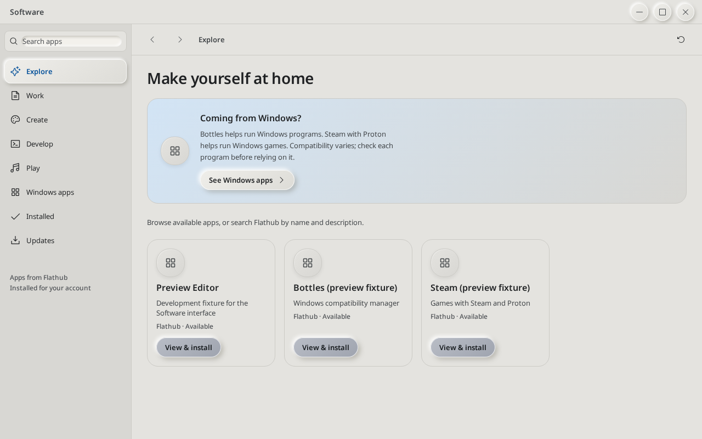
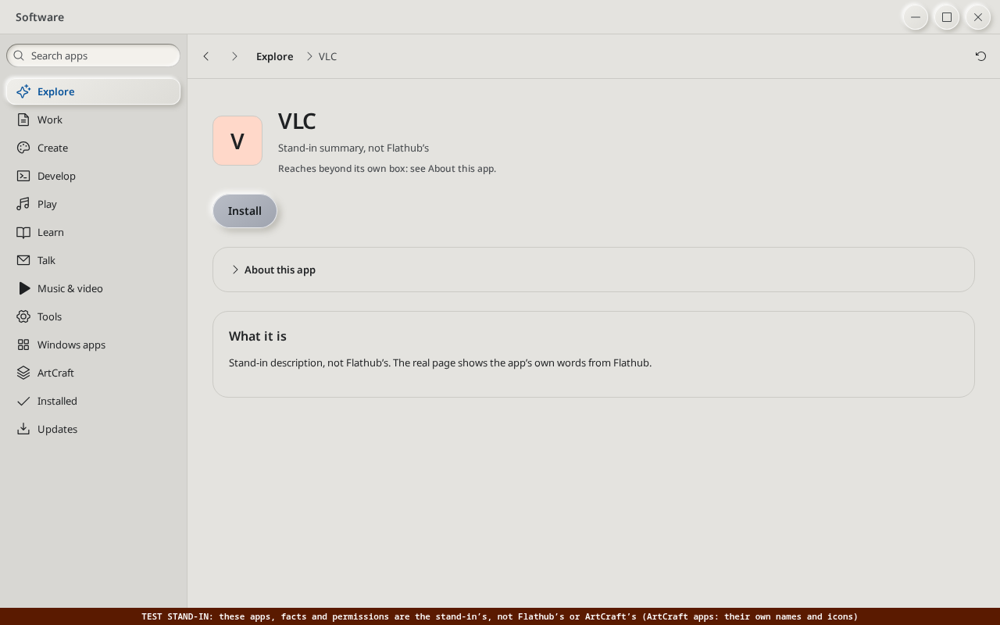

### Installer files

Opening an installer downloaded from the web gives SIX's own sheet instead of "No app opens this
kind of file", one for each kind, read from the file's content: a **Windows program** ("This is a
Windows program.": the same app in Software first, else Bottles with "Some Windows programs do not
run"; never run directly, never as administrator), a **`.deb`** (made for Debian and Ubuntu; it
cannot be installed on SIX), an **`.rpm`** (a system package; drivers come through System Check), a
**`.flatpakref`** (from Flathub or from ArtCraft, the app's page; from anywhere else, not
installed), and an **AppImage** ("SIX does not know where this app came from, and nobody has
checked it": **Run once** or **Add to my apps**). Each sheet's parts sit on one gap, and the app it
names shows its logo.

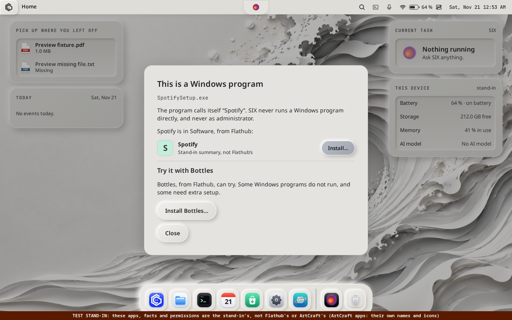
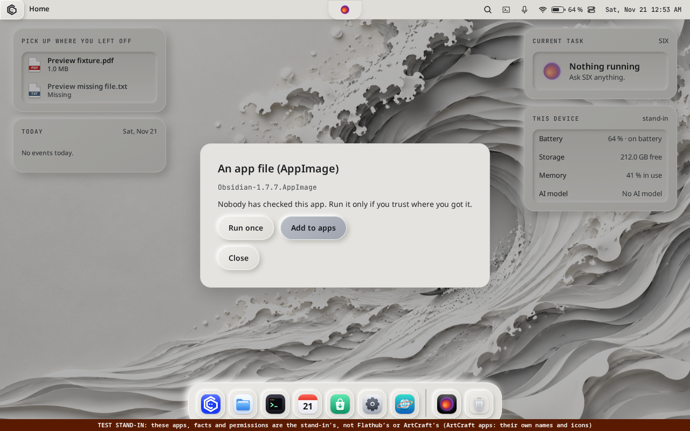

## Calendar

The month in a grid (weekday header, the days as recessed cells, today marked in the accent), ‹
**Today** › at the top, and the chosen day on the right with its events, **Add event** and "Saved
on this computer". Today's events also show in the Today card on home and in the clock's panel.
Deleting an event asks first, with the danger button.

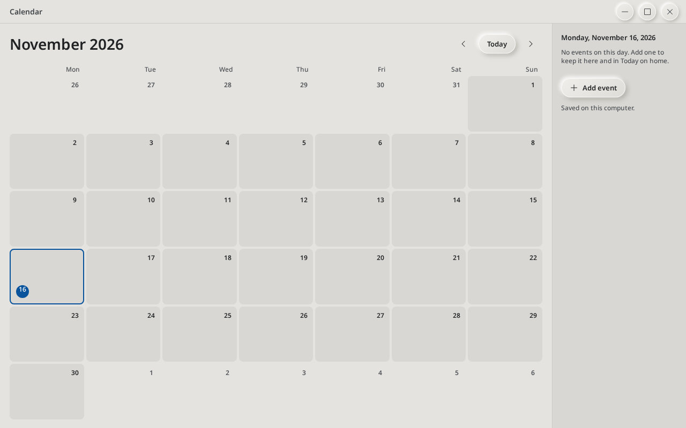

## Terminal

SIX's own terminal: tabs (a tab can be torn off into its own window), **Ask SIX** in the toolbar,
help and settings; a first-use line explains `Ctrl + C` (copies a selection; with none, it stops
the program) and where all its keys are (`Ctrl + Shift + K`). Its own keys use `Ctrl + Shift`
(tabs on `Alt + 1 … 9`, text size on `Ctrl + =`, `-`, `0`), because Super belongs to the desktop.
The **quick terminal** drops down from the top on `Super + `` ` `` over
every app. A long command shows as a ring on the dock's Terminal icon and in the notch. Settings ›
Terminal has the text size and a screen-reader mode. (The picture tool used for this repository
has no real shell behind it, so Terminal is described here and not shown.)

## Lock screen

See [18 · Brand › Sign-in and lock](18-brand.md#sign-in-and-lock).
