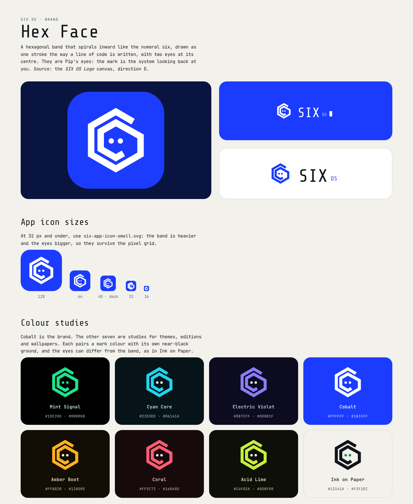
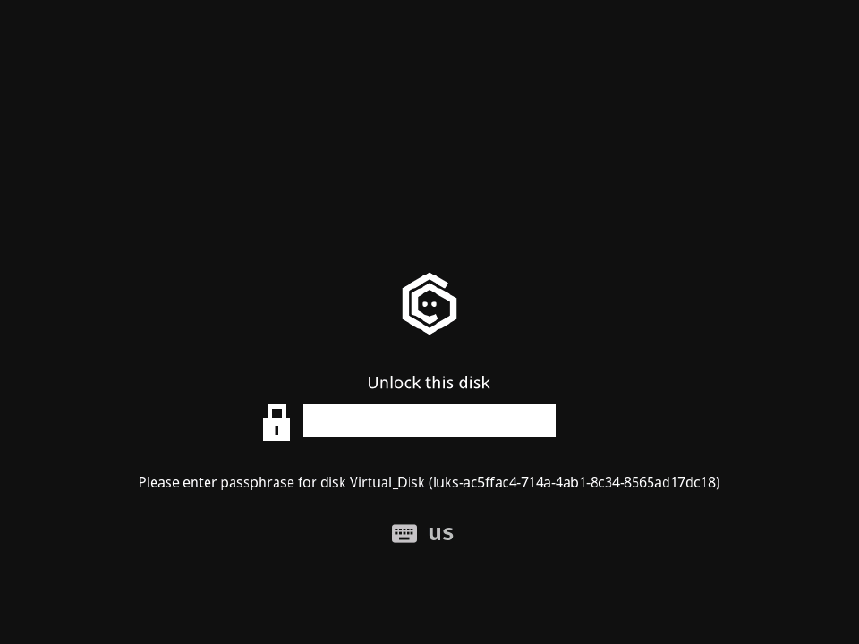
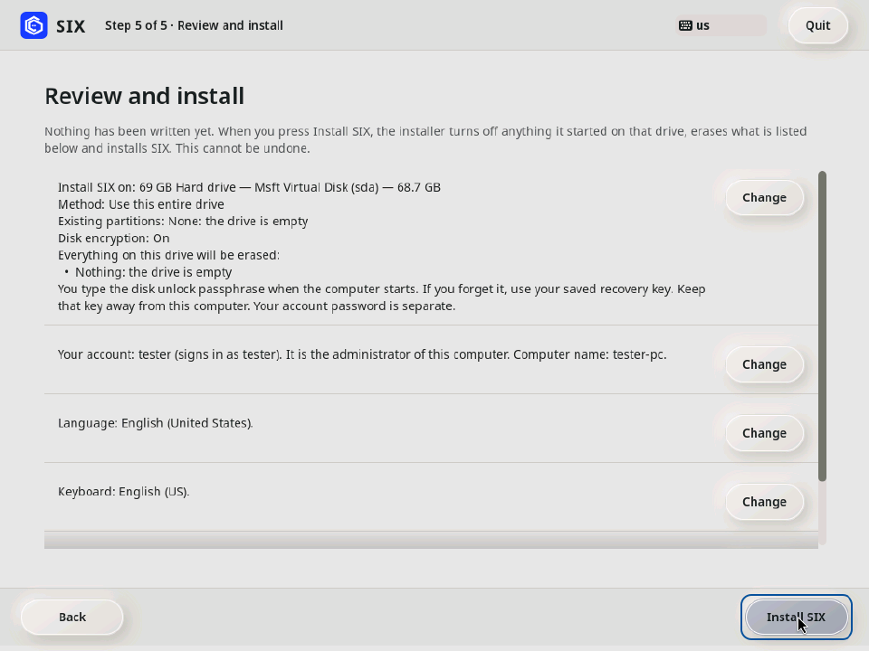

# 18 · Brand: the mark, the wordmark and the boot screen

Source: the SIX logo design canvas (directions D, D2 and E). The assets in
[`brand/`](../brand/) are drawn from it; [`brand/index.html`](../brand/index.html) is the brand
sheet and [`brand/boot.html`](../brand/boot.html) plays the boot screen.

## The mark: Hex Face

A hexagonal band that spirals inward like the numeral six, drawn as one stroke the way a line of
code is written, with two eyes at its centre. The eyes are the assistant's: the mark is the system looking
back at you.

| Part | Drawing (400-unit box, centred on 0,0) |
|---|---|
| Band | One open polyline, `M90.9 -97.5 L0 -150 L-129.9 -75 L-129.9 75 L0 150 L129.9 75 L129.9 -20 L0 -92 L-79.67 -46 L-79.67 46 L0 92 L39.84 69`, stroke 34, mitred joins, butt ends |
| Eyes | Two circles, r 14, at (±24, 4) |
| Small drawing (≤ 32 px) | Stroke 44, eyes r 20 at (±26, 4), so it survives the pixel grid |

| File | Use |
|---|---|
| [`six-mark.svg`](../brand/six-mark.svg), [`six-mark-white.svg`](../brand/six-mark-white.svg) | The mark alone, cobalt or white |
| [`six-app-icon.svg`](../brand/six-app-icon.svg) | App icon: cobalt rounded square (radius 22 % of the side), the mark at 79 % |
| [`six-app-icon-small.svg`](../brand/six-app-icon-small.svg) | App icon at 32 px and under (favicon, tray, notifications) |
| [`six-wordmark.svg`](../brand/six-wordmark.svg), [`six-wordmark-white.svg`](../brand/six-wordmark-white.svg) | SIX with its block cursor, text outlined |
| [`six-lockup.svg`](../brand/six-lockup.svg), [`six-lockup-cobalt.svg`](../brand/six-lockup-cobalt.svg) | Mark and wordmark side by side |

### Rules
- **Clear space:** one band width (about 8 % of the mark) on every side.
- **Minimum size:** 16 px for the mark; the lockup needs the wordmark at 24 px or more.
- **One flat colour** for band and eyes on a flat ground. No gradients on the mark, outlines,
  rotation or added effects. The app icon may carry the dock's shared light, like every app icon.
- **Grounds:** white on cobalt or night (`#0A1440`), cobalt on white or paper (`#F3F1EC`). On a
  photo, put the mark on a cobalt tile.
- **The eyes may blink** (every 4.5–5 s, 6 % of the cycle) where the mark is large and alive: the
  boot screen, About, onboarding. Never in the menu bar, dock or anything a user reads past.
- **The mark is not the assistant.** SIX, the assistant, keeps its own orb (Bloom, Halo, Ripple,
  Dotted, Ink, Mosaic; see [14](14-home-assistant.md)). The mark stands for SIX, the system: the menu-bar button, the SIX menu
  app icon, About, the boot screen, the installer, the login screen and documentation.

## The wordmark

**SIX** in Share Tech Mono, then a block cursor (a fifth of the cap height wide, two fifths tall).
Always the full word SIX; never "SIX OS" on anything a person sees (until October 2026 the
wordmark carried a small OS; it was removed). SIX is ink (`#12141A`) on light grounds and white on
cobalt or dark. When the wordmark is live the cursor blinks once a second; in print and in static
artwork it is solid or left out. The SVGs have the text converted to outlines, so they render
anywhere without the font.

## Colour

| Token | Value | Use |
|---|---|---|
| `--brand` | `#1B3CFF` cobalt | The app icon and the lockup's mark (and the October boot design, below) |
| `--brand-hi` / `--brand-lo` | `#2B50FF` / `#1230D6` | The app icon's top-to-bottom light |
| `--brand-ink` | `#C9D3FF` | Secondary words on cobalt (4.54:1) |
| `--brand-night` | `#0A1440` | The ground behind the app icon in marketing artwork |

Cobalt is the brand, not a UI accent: buttons, selection and focus keep following the user's
accent setting ([04](04-color.md)). `check_contrast.py` verifies the brand pairs.

### Colour studies

Seven more studies from the canvas, for editions, themes and wallpapers. Each pairs a mark colour
with its own near-black ground; the eyes can differ from the band.

| Study | Mark | Eyes | Ground |
|---|---|---|---|
| Mint Signal | `#1DE28D` | `#1DE28D` | `#000000` |
| Cyan Core | `#22D3EE` | `#E6FBFF` | `#06141A` |
| Electric Violet | `#8B7CFF` | `#F1EEFF` | `#0D0B1F` |
| **Cobalt** (the brand) | `#FFFFFF` | `#FFFFFF` | `#1B3CFF` |
| Amber Boot | `#FFB020` | `#FFF4DE` | `#120D05` |
| Coral | `#FF5C72` | `#FFE9EC` | `#160A0D` |
| Acid Lime | `#C4F03A` | `#F7FFE0` | `#0D0F08` |
| Ink on Paper | `#12141A` | `#0B8F55` | `#F3F1EC` |

## Type

The wordmark is Share Tech Mono in both designs. Around it, the interface follows the chosen design
([03](03-typography.md)): Noto Sans in Sculpted, JetBrains Mono and Share Tech Mono in Soft Matter.
The system screens before sign-in use Noto Sans.

## The system screens, today

These run before and around the desktop. They are drawn by the system's own programs (the boot
splash, the sign-in and lock screens, the installer), in SIX's colours, and each has one main
button drawn the way SIX's windows draw it ([19](19-sculpted.md#one-main-button)). Real pictures
from an installed system are in [`screens/installed/`](../screens/installed/README.md).

### Boot

A quiet dark ground, `#111214`, with the white Hex Face (88 px) in the middle and a thin line under
it (160 × 2 px, `#45474E`). While the machine starts, a short white light (24 px) travels along
the line: it says "working", never a percentage. Where the system reports real progress the line
fills in 20 steps from that report. Nothing is held back for an animation: the screen goes as soon
as the system is ready. Updates, firmware and resets use the same screen with a title ("Installing
updates", "Keep your computer on") and a real percentage. GRUB stays hidden unless the last start
failed; its menu uses the same mark and wordmark.

### Disk unlock

When the disk is encrypted (the installer's default), the boot screen asks for the passphrase:
"Unlock this disk" centred above a white field (300 × 40 px) with a padlock beside it; each typed
character is a dot. The keyboard layout is shown under it.

### Sign-in and lock

A full-screen wallpaper with a large clock at the top (a light serif, the date under it), the
person's picture and name, the password field with an eye to show what is typed, the main button
**Sign in** (or **Unlock**) as a full-width pill under the field, and **Switch user** under that.
Along the foot: Accessibility and the session on the left, Sleep, Restart and Shut down on the
right, as ordinary pill buttons. The lock screen follows the design the person chose (Sculpted or
Soft Matter, light or dark) and its palette; the sign-in screen runs before anyone has chosen, so
it keeps SIX's dark look. Fingerprint and face unlock appear only where the hardware exists, only
on these two screens, and the password always works.

### The installer

Five pages in one frame: **Language**, **Basic settings** (keyboard, region, time zone, optional
Wi-Fi), **Where SIX goes** (the drive, the method, disk encryption, on by default), **Your account**
(name, sign-in name, password; this account is the administrator) and **Review and install**, then
**Installing SIX** and the end page. The frame has SIX's mark and name and "Step n of 5 · Page" at
the top left, the keyboard layout and **Quit** at the top right, and **Back** and the main button
(**Next**, **Install SIX**, **Restart**) at the foot. Three button looks only: the main button, the
ordinary button and the dangerous one. The Installing page lists four stages with Done, Now and
Waiting, a bar, and in the long stage a line with the minutes passed; it never says done before it
is. Nothing is written to the drive until **Install SIX** on the review page.

### The October boot design

The animated cobalt boot screen (the eyes popping open, the band drawing itself, SIX typing out
in VT323 and a bracketed loader) is in [`brand/boot.html`](../brand/boot.html) and
[`screens/history/boot.png`](../screens/history/boot.png). It is designed, not built: SIX's boot is
the quiet dark screen above.
