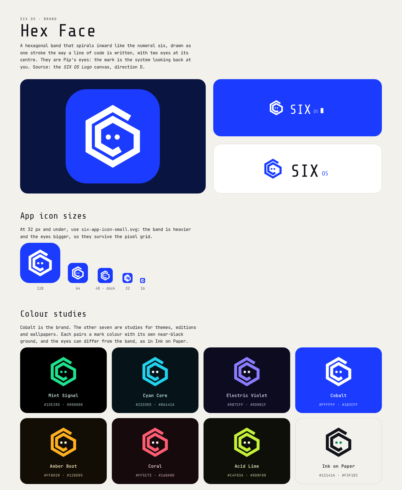
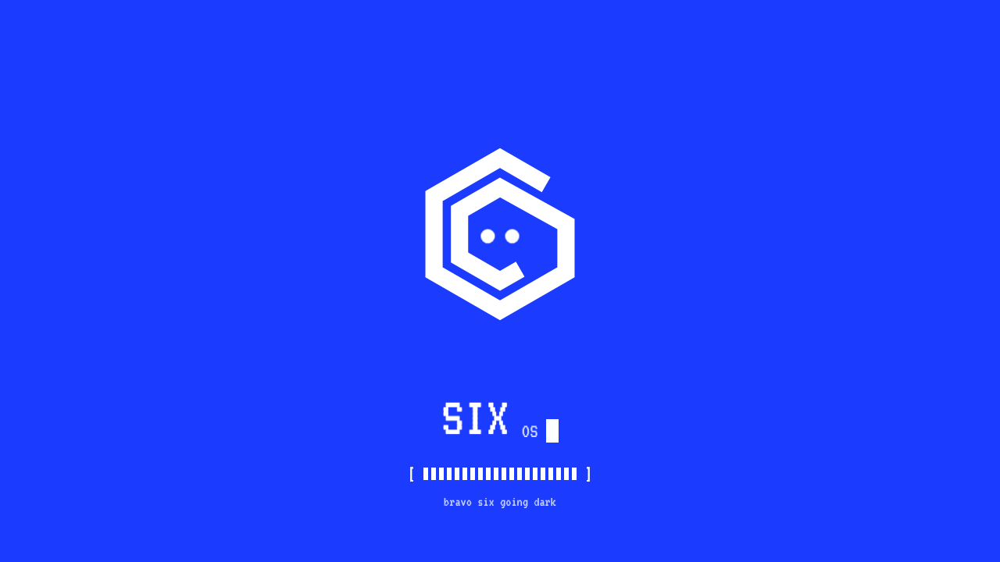

# 18 · Brand: the mark, the wordmark and the boot screen

Source: the *SIX OS Logo* design canvas (directions D, D2 and E). The assets in
[`brand/`](../brand/) are drawn from it; [`brand/index.html`](../brand/index.html) is the brand
sheet and [`brand/boot.html`](../brand/boot.html) plays the boot screen.

## The mark: Hex Face

A hexagonal band that spirals inward like the numeral six, drawn as one stroke the way a line of
code is written, with two eyes at its centre. The eyes are Pip's: the mark is the system looking
back at you.

| Part | Drawing (400-unit box, centred on 0,0) |
|---|---|
| Band | One open polyline, `M90.9 -97.5 L0 -150 L-129.9 -75 L-129.9 75 L0 150 L129.9 75 L129.9 -20 L0 -92 L-79.67 -46 L-79.67 46 L0 92 L39.84 69`, stroke 34, mitred joins, butt ends |
| Eyes | Two circles, r 14, at (±24, 4) |
| Small drawing (≤ 32 px) | Stroke 44, eyes r 20 at (±26, 4), so it survives the pixel grid |

| File | Use |
|---|---|
| [`six-mark.svg`](../brand/six-mark.svg), [`six-mark-white.svg`](../brand/six-mark-white.svg) | The mark alone, cobalt or white |
| [`six-app-icon.svg`](../brand/six-app-icon.svg) | App icon: cobalt rounded square (radius 22 % of the side), the mark at 79 % |
| [`six-app-icon-small.svg`](../brand/six-app-icon-small.svg) | App icon at 32 px and under (favicon, tray, notifications) |
| [`six-wordmark.svg`](../brand/six-wordmark.svg), [`six-wordmark-white.svg`](../brand/six-wordmark-white.svg) | SIX OS with its cursor, text outlined |
| [`six-lockup.svg`](../brand/six-lockup.svg), [`six-lockup-cobalt.svg`](../brand/six-lockup-cobalt.svg) | Mark and wordmark side by side |

### Rules
- **Clear space:** one band width (about 8 % of the mark) on every side.
- **Minimum size:** 16 px for the mark; the lockup needs the wordmark at 24 px or more.
- **One flat colour** for band and eyes on a flat ground. No gradients on the mark, outlines,
  rotation or added effects. The app icon may carry the dock's shared light, like every app icon.
- **Grounds:** white on cobalt or night (`#0A1440`), cobalt on white or paper (`#F3F1EC`). On a
  photo, put the mark on a cobalt tile.
- **The eyes may blink** (every 4.5–5 s, 6 % of the cycle) where the mark is large and alive: the
  boot screen, About, onboarding. Never in the menu bar, dock or anything a user reads past.
- **The mark is not Pip.** Pip keeps its own orb (Bloom, Halo, Ripple, Dotted; see
  [14](14-home-assistant.md)). The mark stands for SIX itself: the menu-bar button, the Six Menu
  app icon, About, the boot screen, the installer, the login screen and documentation.

## The wordmark

**SIX** in Share Tech Mono, a small **OS** at 36 % of its size sitting on the same baseline, then
a block cursor (a fifth of the cap height wide, two fifths tall). In the light lockup, SIX is ink
(`#12141A`) and OS is cobalt; on cobalt, SIX is white and OS is `#C9D3FF`. When the wordmark is
live (About, the boot screen) the cursor blinks once a second; in print and in static artwork it
is solid or left out. The SVGs have the text converted to outlines, so they render anywhere
without the font.

## Colour

| Token | Value | Use |
|---|---|---|
| `--brand` | `#1B3CFF` cobalt | The app icon, the boot screen, the lockup's mark |
| `--brand-hi` / `--brand-lo` | `#2B50FF` / `#1230D6` | The app icon's top-to-bottom light |
| `--brand-ink` | `#C9D3FF` | OS in the wordmark and the status line on cobalt (4.54:1) |
| `--brand-night` | `#0A1440` | The ground behind the app icon in marketing artwork |

Cobalt is the brand, not a UI accent: buttons, selection and focus keep following the user's
accent setting ([04](04-color.md)). `check_contrast.py` verifies the brand pairs.

### Colour studies

Seven more studies from the canvas, for editions, themes and wallpapers. Each pairs a mark colour
with its own near-black ground; the eyes can differ from the band.

| Study | Mark | Eyes | Ground |
|---|---|---|---|
| Mint Signal | `#1DE28D` | `#1DE28D` | `#000000` |
| Cyan Core | `#22D3EE` | `#E6FBFF` | `#06141A` |
| Electric Violet | `#8B7CFF` | `#F1EEFF` | `#0D0B1F` |
| **Cobalt** (the brand) | `#FFFFFF` | `#FFFFFF` | `#1B3CFF` |
| Amber Boot | `#FFB020` | `#FFF4DE` | `#120D05` |
| Coral | `#FF5C72` | `#FFE9EC` | `#160A0D` |
| Acid Lime | `#C4F03A` | `#F7FFE0` | `#0D0F08` |
| Ink on Paper | `#12141A` | `#0B8F55` | `#F3F1EC` |

## Type

Terminal type throughout ([03](03-typography.md)): JetBrains Mono for everything you read, Share
Tech Mono for display sizes and the wordmark, VT323 for the boot screen only.

## The boot screen

On cobalt, in VT323, about six seconds from power-on. Times are seconds from the moment the
screen appears:

| Time | What happens | Motion |
|---|---|---|
| 0.15–0.60 | A black frame fades to cobalt: the panel powering on | ease-out |
| 0.50–0.95 | The eyes pop open | `cubic-bezier(0.3, 1.6, 0.5, 1)`, an overshoot |
| 1.0 → | The eyes blink every 4.5 s | squash to 10 % height and back in 8 % of the cycle |
| 1.30–2.80 | The hex band draws itself around the eyes, from the outer end inward | `cubic-bezier(0.65, 0, 0.35, 1)` on the stroke length |
| 2.70 → | The terminal cursor appears and blinks once a second | stepped |
| 2.90–3.52 | S, I, X, then O, S type one letter every 0.12 s | stepped |
| 3.40 → | SIX glitches for 0.2 s every 2.8 s: a jitter with cyan (`#4DF3FF`) and magenta (`#FF3E9A`) slices | |
| 3.80–5.50 | The loader runs; the status line types out underneath | |
| 6.30 | The screen fades to the session in 0.62 s, and the desktop's ripple plays from the centre | ease-in |

**Loaders** (Settings › About › Startup screen): **Terminal** (the default: `[` 20 cells `]`
switching on at a slightly uneven pace, like real work), **Scan** (a 280 px line with a sweeping
segment that then fills), **Counter** (`> 0%` to `> 100%`) and **Hexagons** (six hex outlines
filling one by one).

**Status line:** *bravo six going dark* at start and restart; *restarting into 1.0.3* (the
version) when an update is being switched to.

**Rules:**
- Any key, click or tap skips it, and a **Skip** button sits top right.
- **Reduced motion** shows the finished frame (mark drawn, wordmark typed, loader full) for
  1.4 s, then fades.
- **It never slows boot down.** On a real machine the loader follows real progress (below); if
  the system is ready before the band has drawn, the screen fades to the login screen at once.
- The stage is drawn at 1280 × 720 and scaled to fit the screen, so proportions never change.

### On the device: a Plymouth theme

SIX replaces `fedora-logos` and Fedora's Plymouth theme with its own package (`six-logos`), as
the trademark rules require ([17](17-fedora.md#building-on-fedora-names-and-branding)). The boot
screen is a **Plymouth script theme**, `six`:

| Piece | How |
|---|---|
| Ground | `Window.SetBackgroundTopColor` / `BottomColor` to cobalt (`0.106, 0.235, 1.0`) |
| Mark | Plymouth can't stroke paths, so the band ships as a sprite sequence: 46 PNG frames of the draw rendered from `six-mark-white.svg` at 1× and 2× (the 2× set on HiDPI screens). The eyes are separate sprites, scaled for the pop and blink |
| Wordmark | Per-letter sprites rendered in VT323 (the theme can't rely on font rendering this early), revealed on the same timeline |
| Loader | `Plymouth.SetBootProgressFunction` drives the cells from **real** boot progress; the timeline above is the shape of a typical boot, not a delay |
| Disk password | `Plymouth.SetDisplayPasswordFunction`: the mark stays, the loader line becomes `> passphrase: ••••▮` in VT323 |
| Messages | `Plymouth.SetMessageFunction` replaces the status line with the system's message when there is one (for example, a file-system check) |
| Shutdown and restart | The same screen; the eyes close at the end, and the status line reads *going dark* |
| Hand-over | The screen fades to the SIX login screen (GDM), which starts on cobalt with the mark in place, so there is no black flash |

GRUB stays hidden, as Fedora hides it, unless the last boot failed; its menu uses the cobalt
ground and VT323 too. The installer and the firmware update screen use the brand sheet's lockups.
