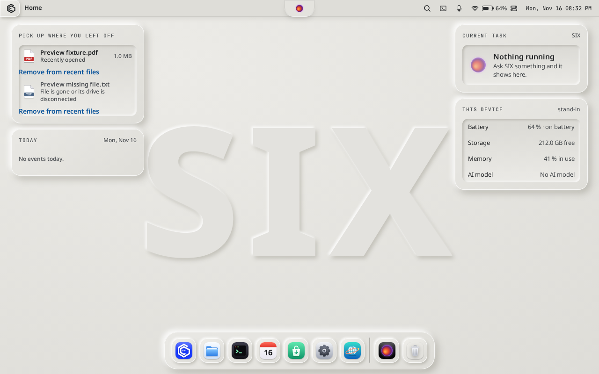
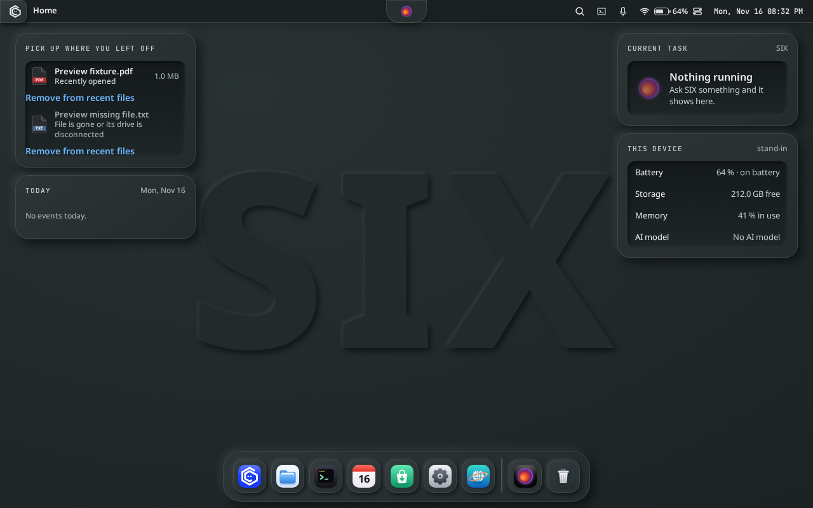

# 19 · Sculpted: SIX's default design

SIX has two designs, chosen in Settings › Appearance › Design and switched live, without a restart:

| | **Sculpted** (default since 2026-10-31) | **Soft Matter** (the original) |
|---|---|---|
| Character | Ivory surfaces, deep recessed channels and sculpted edges in light; graphite instrument panels and machined aluminium controls in dark. Controls are raised and physical; a pressed control sinks in | Satin controls and panels, clay icons and tiles, paper windows, and home cards drawn as shallow water that fuse when close ([05](05-materials.md)) |
| Light / dark | Ivory finish / Graphite finish | Porcelain / Ink |
| Accent | A limited signal: Blue (default), Mint, Amber, Lavender | Graphite (silver in the dark, default), Iris, Tide, Moss, Sun |
| Type | Noto Sans for the interface, JetBrains Mono for short labels and values | JetBrains Mono everywhere, Share Tech Mono for display sizes ([03](03-typography.md)) |
| Motion | 120 / 180 / 240 ms, ease-out, no overshoot | Springs with a little overshoot, tension ([08](08-motion.md)) |
| Home | A tonal ground with SIX embossed in it; cards are raised tiles | A drawn wallpaper; cards are plasma water |
| Tokens | [`tokens/sculpted.css`](../tokens/sculpted.css), on top of [`tokens/tokens.css`](../tokens/tokens.css) | [`tokens/tokens.css`](../tokens/tokens.css) |

Sculpted is what a new person gets and what anyone who never chose a design gets. Other apps (Qt,
GTK, the terminal, LibreOffice and the window frames) wear Sculpted by default too, with matching
colour schemes for light, dark and each accent. A person who picks a design keeps it.

Both designs share one set of role names (`--c-text`, `--c-surface`, `--radius-md`, `--dur-base` …).
Sculpted sets those names to its own values, so a screen is written once and drawn in either design.

"Buttons should feel like buttons."

## The palette

Values from the product ([`tokens/sculpted.css`](../tokens/sculpted.css), section 1).

| Role | Token | Ivory (light) | Graphite (dark) |
|---|---|---|---|
| Ground | `--sc-ground` | `#E7E6E2` | `#202729` |
| Raised surface | `--sc-surface` | `#E4E3DF` | `#283032` |
| Recessed (channels, wells) | `--sc-inset` | `#D8D7D3` | `#191F21` |
| Deeper well | `--sc-inset-2` | `#CFCEC9` | `#2F383B` |
| Text field | `--sc-field` | `#F3F1EC` | `#161B1D` |
| Top bar | `--sc-bar` | `#DEDDD8` | `#1B2123` |
| Text | `--sc-text` | `#1F2123` | `#E9EEEC` |
| Secondary text | `--sc-text-2` | `#43474A` | `#C3CBC8` |
| Lightest text allowed | `--sc-text-3` | `#4F5256` | `#A3ADAA` |
| Hairline | `--sc-line` | `#CBCAC5` | `#374143` |
| Meaningful edge (3:1) | `--sc-line-strong` | `#75746F` | `#7A8582` |
| Switch on (green) | `--sc-switch-a` → `-b` | `#25834C` → `#1C7343` | `#3CB06F` → `#2F9A5D` |
| Success / warning / error / info | `--sc-ok` `--sc-warn` `--sc-bad` `--sc-info` | `#1C6B3A` `#7A4D00` `#9C2A1B` `#0A5F6B` | `#7FD9A0` `#F0B44A` `#FF9A88` `#6FD3DF` |
| The dark window (live things) | `--sc-ink` | `#2B3033` | `#0E1213` |

**The signal accent.** Three values per accent: `--sc-accent` for text, links and filled badges
(4.5:1 on every surface), `--sc-signal` for slider fills, indicators and rings (3:1 against the
track), `--sc-soft` for the tint behind a selected row.

| Accent | Ivory: accent / signal / soft | Graphite: accent / signal / soft |
|---|---|---|
| **Blue** (default) | `#08539B` / `#087BDC` / `#D2E4F5` | `#6BB8FF` / `#4AA3F5` / `#1C3A55` |
| Mint | `#0A6248` / `#108A67` / `#CFE9DD` | `#5FD8B0` / `#3FC79B` / `#17403A` |
| Amber | `#744500` / `#A86A00` / `#F0DCB4` | `#F0B44A` / `#E0A030` / `#44330F` |
| Lavender | `#4D32B4` / `#7A5FE0` / `#DDD5F5` | `#B3A2FF` / `#9D8AFF` / `#302A5A` |

**Switches are green when on.** The green passes 3:1 against the track and the surface, and the
knob also moves to the on side, so colour is never the only signal.

## Depth

Raised is a light edge top-left plus a soft shadow bottom-right, and a 1 px inner rim; recessed is
the reverse, inside. Three strengths:

| Token | Recipe (Ivory) | Used for |
|---|---|---|
| `--sc-raise` | `-5px -5px 12px` light, `6px 7px 16px` shadow | Panels, windows, cards |
| `--sc-raise-s` | `-3px -3px 7px`, `4px 4px 9px` | Buttons, tiles |
| `--sc-raise-xs` | `-2px -2px 4px`, `2px 3px 6px` | Small controls, dock tiles, chips |
| `--sc-press` | `inset 3px 3px 7px` shadow, `inset -3px -3px 6px` light | A pressed control |
| `--sc-well` | `inset 4px 4px 9px`, `inset -3px -3px 7px` | Channels: tracks, sidebars, fields |

Light is `rgba(255,255,255,.92)` and shadow `rgba(112,108,94,.36)` in Ivory; `rgba(255,255,255,.075)`
and `rgba(0,0,0,.55)` in Graphite, which keeps the same depth with a faint light rim. Controls are
filled with a 145° two-stop gradient (`#EFEEEA` → `#DDDCD7`; `#333C3F` → `#272F31`).

**More contrast and Reduce transparency** flatten the depth: every raise and well becomes a 1.5 px
line in `--sc-line-strong` (2 px on hover and press), and secondary text takes the main text colour.
Nothing is lost but the shadows. **High contrast** goes further ([11](11-accessibility.md)).

## Geometry

| | Value |
|---|---|
| Radii | 8 (`--radius-sm`), 12 (`--radius-md`), 20 (`--radius-lg`), 24 (`--radius-xl`), 28, pill |
| Spacing | the shared 4 px grid ([06](06-layout.md)) |
| Controls | 44 px tall (36 dense, 52 large); 16 px side padding; icons 18 to 20 px |
| Touch mode | controls 52 px, title bar 52 px, top bar 40 px, dock 88 px |
| Windows | 24 px corners, a 44 px title bar with the title in Noto Sans 600 14/20, buttons on the right |
| Top bar | 36 px, `--sc-bar`, a hairline under it |
| Dock | 80 px; a centred raised tray with 28 px corners, 10 px above the edge |
| Focus | a 2 px ring in the accent, 3 px off the control |

## Type in Sculpted

| Token | Value |
|---|---|
| `--text-display` | Noto Sans 700, 48/50 |
| `--text-headline` | Noto Sans 700, 40/46 |
| `--text-title-lg` | Noto Sans 600, 28/34 |
| `--text-label` | Noto Sans 600, 13/16 |
| `--text-overline` | JetBrains Mono 500, 11/16 |
| `--text-hero` | Noto Sans 300, 96/96 (the lock clock) |
| Body | the shared 14/20 and 13/18 sizes, in Noto Sans, no tracking |

## States

| State | Looks like |
|---|---|
| Default | raised surface and a fine edge |
| Hover | only the rim brightens (`#FFFFFF`; `rgba(255,255,255,.26)` in Graphite); no glow, no colour change |
| Pressed | inset, and the control travels 1 px |
| Selected | its position plus a shape or a check; a selected row is recessed, its words in the accent |
| Disabled | muted, flat, a 1 px line, no activation |
| Focus | 2 px ring in the accent, 3 px offset |

## One main button

Every screen draws "the button you press to go on" the same way: SIX's windows, and the screens
outside them (lock, sign-in, the password window, "SIX needs to restart", the start-up screen, the
installer). A screen has **one main button**, any number of **ordinary** ones, and a **dangerous**
one only where something is lost. A pill (radius half the height); words centred, never wrapped
when there is room; the main button on the trailing side of a row, or alone and full width under
a field.

| | Sculpted | Soft Matter |
|---|---|---|
| Height, padding | 44 px, 0 20 px | 36 px, 0 16 px |
| Words | Noto Sans 600, 14 px | JetBrains Mono 600, 13 px |
| Fill direction | 145° | top to bottom |
| Focus ring | 2 px in the accent, 2 px gap | 2 px in `--c-focus`, 2 px gap |

**Sculpted, Ivory / Graphite**

| Button | Fill (two stops) | Words |
|---|---|---|
| Main | `#B9BDC6` → `#9FA4AF` / `#D3DBD8` → `#AEB8B5` | `#14181B` / `#101315` |
| Ordinary | `#EFEEEA` → `#DDDCD7` / `#333C3F` → `#272F31` | `#1F2123` / `#E9EEEC` |
| Dangerous | the ordinary fill | `#9C2A1B` / `#FF9A88` |
| Disabled | `#D8D7D3` / `#191F21`, a 1 px line, no raise | `#4F5256` / `#A3ADAA` |

**Soft Matter, light / dark (Graphite accent)**

| Button | Fill | Words |
|---|---|---|
| Main | the accent, 92 % with white → 82 % with black / 80 % with white → 78 % with black | `#FFFFFF` / `#111214` |
| Ordinary | satin `#FFFFFF` → `#E5E7EA` / `#3A3C42` → `#18191C` | `#16171A` / `#F3F4F6` |
| Dangerous | `--c-danger` `#B13A2A` / `#FF8A78` | the surface colour |
| Disabled | the same button at 45 % | |

Measured on every finish, accent and contrast setting (36 palettes): main 6.27:1 or better,
ordinary 10.56:1 or better, dangerous 5.69:1 or better; the focus ring 5.73:1 or better on a window.

## Motion in Sculpted

Controls 120 ms, panels and menus 180 ms, windows 240 ms, all on one ease-out curve
`cubic-bezier(0.22, 0.61, 0.36, 1)`. The springs used for windows and cards are critically damped
(no overshoot). Reduced motion: no scale, travel or spring; cross-fades of 120 and 160 ms. Details
in [08](08-motion.md).

## Wallpaper and home

An abstract tonal ground (a soft radial gradient from `--sc-wall-a` to `--sc-wall-b`) with a large
"SIX" embossed into it in heavy Noto Sans (140 to 440 px, scaled to the screen), drawn with a light
and a dark text shadow so it reads as pressed into the surface. Strong contrast is kept for
content. Home's cards are raised tiles instead of water. More contrast and High contrast remove the
embossed word.

## What does not change between designs

The Hex Face mark and SIX's app icons; the boot screen (it runs before anyone chooses); the
layout, the names, the shortcuts and every behaviour. Only the material, type and motion change.
