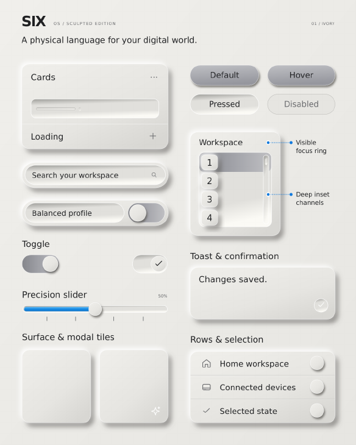
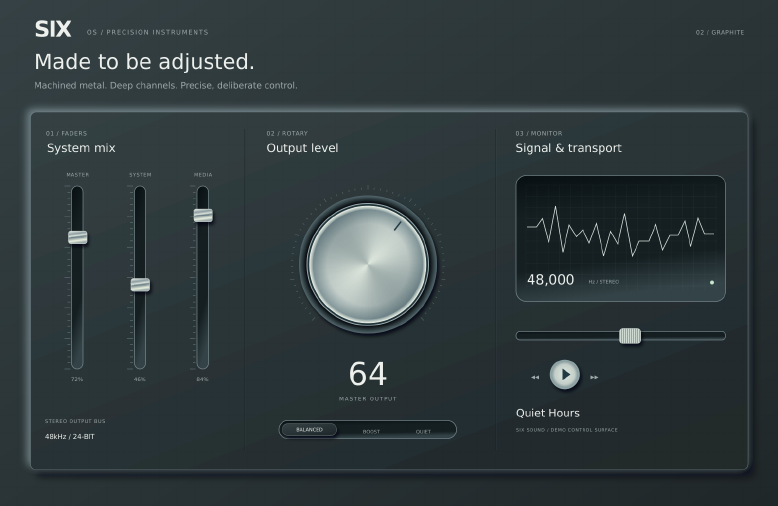

# Sculpted Edition: the October 2026 design exploration

This folder is the design exploration that the **Sculpted** design came from, made for SIX in
October 2026: a 16-page guide ([`six-os-design-guide.pdf`](six-os-design-guide.pdf)), its text
([`guide.txt`](guide.txt)) and each page as a picture ([`pages/`](pages/)).

- It is a **browser-based design concept**, not the product: its own last page says that native
  services, sign-in, the AI, window snapping, updates and hardware control are proposals there,
  not working features.
- It says **"SIX OS"**, the name used then. The name is now always **SIX**.
- Its sample content (a workspace name, percentages, dates, notes) is not SIX's.

**How Sculpted is in the product today is [guide chapter 19](../guide/19-sculpted.md)**, with the
values SIX really uses ([`tokens/sculpted.css`](../tokens/sculpted.css)). Where this exploration
and chapter 19 differ, chapter 19 is right: for example, SIX draws switches green when they are on,
sets every word to pass the contrast rule in every accent, and gives every screen one main button.

| Pages | |
|---|---|
|  |  |
